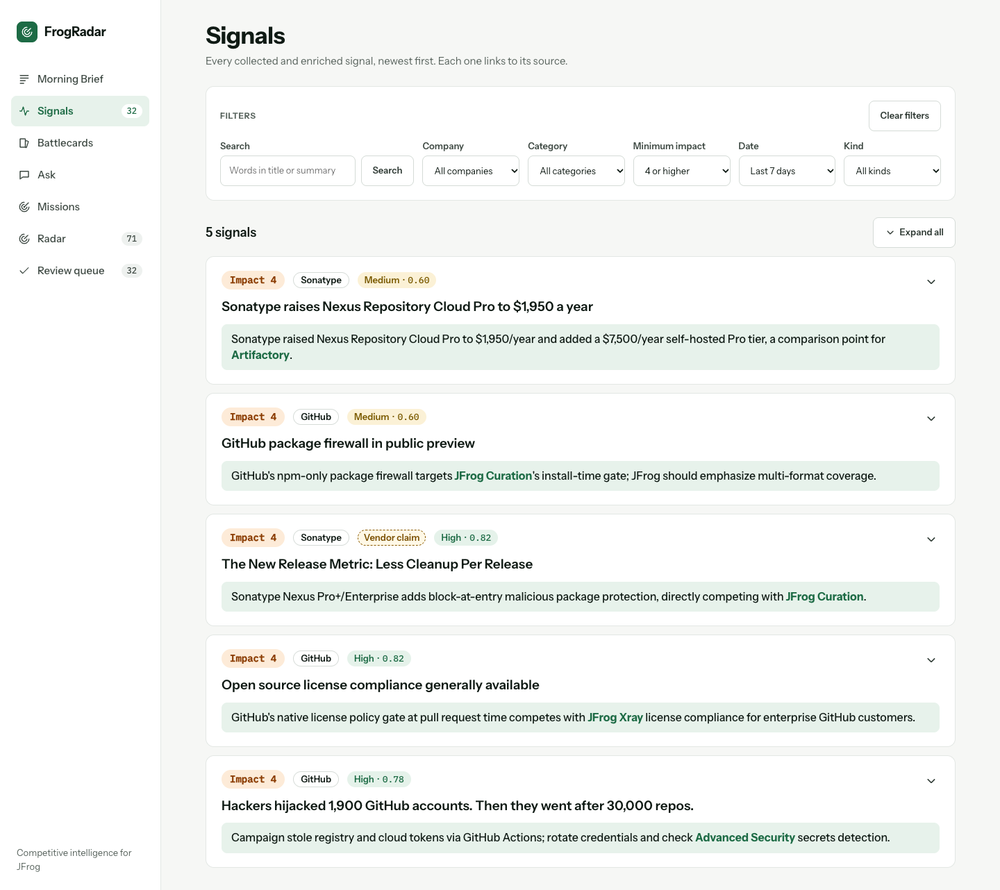

# FrogRadar

AI-powered competitive intelligence for JFrog. A daily pipeline collects industry signals (blogs, release
feeds, GitHub, pricing-page changes), enriches and verifies them with LLMs, and stores everything in one
data model that powers the Morning Brief, battlecards, cited chat, research missions and an MCP server.

> Status: backend pipeline in place (collectors incl. pricing-page diffs with a Wayback baseline, dedup,
> triage, enrichment, cross-provider verification, confidence, daily scheduler). The UI is next.

## Quick start

Requirements: Docker, [uv](https://docs.astral.sh/uv/), Node 20 (frontend).

```bash
cp .env.example .env        # fill in API keys (never commit .env)
make up                     # Postgres + backend (no paid runs); the backend applies migrations on start
make seed                   # load competitors, sources and capabilities from config/
curl localhost:8000/health
```

## Commands

| Command | What it does |
|---|---|
| `make up` / `make down` | Start Postgres + backend (never the scheduler) / stop everything incl. the scheduler |
| `make db-up` | Start only Postgres and wait until healthy |
| `make migrate` | Apply Alembic migrations (`backend/app/db/migrations`) |
| `make seed` | Upsert entities, sources, capabilities from `config/` (safe to re-run) |
| `make test` | Backend tests, incl. migrations and seed on a real throwaway Postgres DB (LLM calls faked) |
| `make test-live` | Tests marked `live`: real provider calls (needs keys in `.env`, costs < 1 cent). The only way they run. |
| `make llm-smoke` | One tiny call per LLM tier + one embedding; prints model, latency, tokens, cost |
| `make collect` | Collect new items from all active sources (`SOURCE="Snyk Blog"` or `SOURCE=12` for one) |
| `make backfill` | Page back through history (`SINCE=90d` default, or `SINCE=2026-01-01`) |
| `make embed` | Embed in-scope signals without an embedding (paid: embedding API, cached per text) |
| `make dedup` | Semantic dedup into clusters (no LLM calls) |
| `make link` | Rule-based entity linking from names/aliases in `competitors.yaml` (no LLM calls) |
| `make dedup-report` | Calibration report: most similar pairs, similarity distribution, entity link counts |
| `make pipeline` | The daily pipeline (LangGraph), paid: `ARGS="--skip collect"`, `ARGS="--force enrich,verify"` |
| `make brief` | The daily brief only (1 synthesis + 1 verify call, once per UTC day; `ARGS="--force brief"`) |
| `make battlecards` | Battlecards for due competitors (1 synthesis + 1 verify call each; `ARGS="--force battlecards"`) |
| `make radar-backfill` | Competitor Radar discovery for the last 90 days: Hacker News, GitHub new repos, CNCF landscape copies (no LLM calls) |
| `make radar` | Radar step: candidates, emergence score, profiles of the top candidates (paid: bulk + verify; `ARGS="--force radar"`) |
| `make pipeline-report` | Quality report of the latest run (`RUN=<id>`): triage, distributions, cost per model, samples |
| `make wayback-backfill` | Baseline for page_diff sources: Wayback snapshots ~12/6/3 months back + today, diffed in date order (no LLM calls; `SOURCE=` for one) |
| `make scheduler-up` / `make scheduler-down` | Opt in / out of the daily paid run (`scheduler` compose profile, `DAILY_RUN_CRON`, UTC) |
| `make scheduler-logs` | Follow the scheduler's log |
| `make eval-select` / `eval-pairs` | Eval set (40 signals) / dedup pairs (40, across similarity bands) → `eval/` (no LLM calls) |
| `make eval-embed` | Embed the full catalog for dedup calibration (paid, ~$0.005) |
| `make eval-label` | Silver labels from the synthesis model for the eval set and the pairs (paid, ~$0.70, cached) |
| `make eval` | Eval pass (triage → enrich → verify + verifier thinking A/B) vs silver labels → `eval/results/` (paid for uncached items only; never writes to `signals`) |
| `make eval-ask` | Ask eval (`eval/ask_questions.yaml`): recall@k, cites-expected, not-enough-evidence, cost → `eval/results/ask_*` (paid; `ARGS="--retrieval-only"` = embeddings only; `--cap 0.60`) |
| `make eval-compare A=… B=…` | Headline metrics of two eval runs side by side |
| `make eval-gold` | Analyst-reviewed signals → `eval/gold_labels.csv` (eval format, no LLM); `make eval ARGS="--labels eval/gold_labels.csv"` scores the pipeline against them |
| `make api-types` | Export the OpenAPI schema and regenerate the frontend's TypeScript types (commit both) |
| `make screenshots` | Playwright screenshots of the Brief, Radar list, Radar detail, Battlecard (Sonatype) and Signals (filtered) at 1440 / 390 px with the local Google Chrome (API on :8000, `ng serve` on :4200, `FRONTEND_URL` / `API_URL` to override) |
| `make lint` | ruff check + format check |

## Configuration (`config/`)

All "what to track" settings are YAML, validated by Pydantic on load (`backend/app/core/catalog.py`):

- `competitors.yaml` – companies (incl. JFrog as `self`), relationship, aliases (with optional match rules for
  ambiguous names), segments, products (a product can be marked `discontinued`), sources
- `sources.yaml` – industry sources not tied to one competitor
- `capabilities.yaml` – capability taxonomy by segment (artifact management, supply-chain security, MLOps, CI/CD, distribution)
- `jfrog_capabilities.yaml` – JFrog's own level per capability for the battlecard matrix, each with a note and the
  public JFrog doc it comes from; `unknown` where no doc clearly states it (never from the LLM)
- `llm_routing.yaml` – model per task (bulk / synthesis / verify), embedding model + dimension, fallback pricing
- `pipeline.yaml` – embedding input, dedup window and thresholds, LLM parallelism, text limits per stage,
  confidence weights / caps / bands, daily brief window, battlecard refresh rules
- `discovery.yaml` – Competitor Radar: discovery sources and their queries (Hacker News, GitHub search, CNCF
  categories), the GitHub noise filter, the ignore list, merge thresholds, emergence-score weights, profile limits

Adding a competitor = add a block to `competitors.yaml`, then `make seed`.

## Data model

`entities` (companies/products) · `sources` · `signals` (one event: summary, why JFrog cares, impact,
confidence, evidence quote, verification, embedding) · `signal_entities` · `insights` + `insight_signals` ·
`feedback` (analyst actions) · `missions` + `mission_steps` · `capabilities` + `capability_matrix` ·
`page_snapshots` · `watch_topics` · `pipeline_runs` · `llm_calls` (tokens, cost, latency, prompt version) ·
`llm_cache` (validated LLM outputs and embeddings by content hash; also feeds demo mode) · `reports`
(stored briefs, battlecards, digests) · `radar_candidates` (discovered players: mentions, sources, metrics,
score + breakdown, profile, status, merges) · `repo_star_snapshots` (GitHub stars per repo per day).
Models: `backend/app/db/models/`.

## Demo scope

The demo runs on **3 curated sources plus 2 watched pricing pages**; the full catalog stays in `config/`:
**13 competitors** (plus JFrog itself) and **47 sources**, every other source set to `is_active: false`.

| Source | Why it's in the demo |
|---|---|
| Sonatype Blog | Direct competitor in artifact management and supply-chain security (Nexus) |
| GitHub Changelog | High-frequency changelog of a major platform: steady stream of concrete product changes |
| The New Stack | Industry press: mentions many vendors, so it exercises entity linking and cross-source dedup |
| Sonatype Pricing (page diff) | The closest competitor's price list: tiers, editions, consumption pricing |
| GitHub Pricing (page diff) | Plans and add-ons (Advanced Security, Actions minutes, Packages storage) of the largest platform |

To widen the scope, set `is_active: true` on a source (or remove the flag) and run `make seed`; nothing needs
to be deleted or re-added. Signals already collected from inactive sources stay in the DB, but later
pipeline stages (dedup, enrichment, verification) only process signals whose source is active
(`app/pipeline/scope.py`).

## Collectors (`backend/app/pipeline/collectors/`)

`make collect` reads every active source and stores raw signals (no LLM calls):

- **RSS/Atom** (feedparser). Teaser items (< 500 chars) get the article fetched and the main text extracted
  (trafilatura); articles already stored are not fetched again.
- **GitHub releases** for the repos listed in `options.repos` (REST API; set `GITHUB_TOKEN` for 5000 instead of
  60 requests/hour). Drafts skipped, pre-releases flagged in `signals.meta`.
- **page_diff**: watched pages (pricing, features), see [Page diff watcher](#page-diff-watcher-and-wayback-baseline).
- **web**: stub (not planned yet).

Good citizenship: identifying User-Agent, robots.txt per host, ≥1s between requests to one host (Crawl-delay
honoured), conditional GET, timeouts. A failing source never stops the run; every run writes a `pipeline_runs`
row with per-source counts (new / updated / duplicate / failed / too old) and errors.

**History limits.** RSS feeds only list their most recent items (often 10–50), so a backfill can't reach further
back than the feed does; GitHub releases page back as far as `--since`. The collect/backfill report says per
source whether it covered the whole window or "only back to <date>". First 90-day backfill over the full catalog
(2026-10-20, before the demo scope was narrowed):

| Coverage | Sources |
|---|---|
| Full 90 days | all 10 GitHub sources; Snyk, Chainguard, Cloudsmith, Hugging Face blogs; GitLab and Artifact Registry release notes |
| ~7 weeks | JFrog Blog (from 2 Sep), Azure DevOps Blog (from 11 Aug) |
| 2–4 weeks | Sonatype Blog, GitLab Blog, Endor Labs Blog, GitHub Blog, Socket Blog |
| Days | GitHub Changelog, The New Stack, InfoQ, BleepingComputer (high-volume feeds list only the latest items) |
| Not collected | Docker, OpenSSF and CNCF blogs block our HTTP client (403); we don't work around bot protection |

Feeds whose items are `#anchors` on one page (release notes) need `options.keep_fragment: true` so each entry
stays its own signal.

**Collected text is for analysis only.** `signals.raw_text` feeds enrichment, verification and search; it is never
shown in the UI or returned verbatim by the API/MCP. Users see a summary, a short evidence quote and a link to
the original.

## Page diff watcher and Wayback baseline

Pricing pages don't publish a feed, so FrogRadar keeps snapshots and reports what changed
(`backend/app/pipeline/page_diff.py`, `collectors/page_diff.py`, `wayback.py`).

- **Text:** the page's main content (trafilatura, or a CSS `options.selector`), normalized line by line: dates,
  "© 2026", "3 days ago", cookie and navigation lines removed; runs of very short lines joined (`$` `4`
  `per user/month` → `$ 4 per user/month`). Prices are never touched. Less than 500 characters left → the page
  probably needs JavaScript: the source fails, no snapshot.
- **Structure:** headings (h2–h4), tab panels (ARIA `aria-labelledby`) and parts named in `options.sections`
  (a CSS selector and a label, e.g. Sonatype's Cloud / Self-Hosted toggle) become path lines such as
  `# Nexus Repository > Cloud > Pro Edition`. Without them, Sonatype's two "Pro Edition" prices (Cloud $1,950,
  Self-Hosted $7,500) were indistinguishable. Each snapshot records its text format (`meta.normalizer`); snapshots
  of different formats are never compared, and `make wayback-backfill` re-fetches archived captures to upgrade them
  (`ONLY_AFTER=YYYY-MM-DD` limits which change signals it rewrites).
- **Snapshots:** stored only when the normalized text changed (`page_snapshots`, with `captured_at` = when the page
  looked like this and `meta.origin` live / wayback).
- **What counts as a change:** a line diff against the last snapshot that wasn't noise.
  - Lines that only moved are ignored, unless a feature moved from one plan's section to another's (a section is
    the lines under a price line).
  - Changes under 40 characters are noise, except that any change to a price line counts (`$4` → `$5`). Small
    edits add up, because the next diff is still taken against the last non-noise snapshot.
  - More than 50% of lines changed = a **redesign**: the snapshot is stored and marked `page_restructured`, and
    only the price lines of both versions are compared (`diff_mode: price_lines`), each prefixed with its section
    (`[Nexus Repository > Cloud > Pro Edition] Starting at $1,950 / year`). No price-line change → no signal. The
    stored evidence quote is the page text only; the section goes to `meta.quote_section`.
- **Signal:** title "Pricing page changed: <source>", dated to the later snapshot; its text is a readable diff of the
  changed sections only (`[before]`, `[after]`, `[context]` lines, a format note, and a list of features that moved
  between plans). It goes through triage → enrich → verify like any other signal, with its own prompt
  (`enrich_page_diff`: price, tier, limit or feature moved) and an evidence quote that must come from the
  `[after]` text, i.e. the current page. A change that only removed lines has no new text, so its quote comes
  from the removed `[before]` text (`meta.quote_side = "before"`, shown in the UI as "Removed: '…'").
- **Baseline:** `make wayback-backfill` takes the Wayback Machine capture closest to ~12, 6 and 3 months ago
  (within ±31 days; one CDX query, then the raw archived HTML via `id_` URLs, 5 s between requests). A capture whose
  text is under half of today's, or has no price lines while today's page has some, is reported as rendered
  differently and not stored, so no misleading diff is made across it. Missing captures are reported too.

**First baseline (2026-10-21):** 4 snapshots per page (2025-10-21, ~2026-04, ~2026-07, today), 6 change signals:

| Page | Change found |
|---|---|
| Sonatype, Oct → Apr | Nexus Repository editions renamed (Free → Community Edition, Premium → Nexus Repository + Repository Firewall) |
| Sonatype, Apr → Jul | Redesign (70% of lines): per-user monthly prices ($18.67, $57.50 per user/month) replaced by yearly ones ("Starting at $1,620 / year + consumption") |
| Sonatype, Jul → today | Redesign (71%): Nexus Repository split into Cloud and Self-Hosted; Cloud Pro Edition "$1,620 / year" → "$1,950 / year + consumption"; new Self-Hosted Pro Edition "$7,500 / year"; Lifecycle and SBOM Manager price cards removed |
| GitHub, Oct → Apr | "Team discussions" removed from the plan features |
| GitHub, Apr → Jul | Copilot add-on removed from the featured list; "GitHub sandbox (public preview)", usage-based, added |
| GitHub, Jul → today | Secret scanning split into "AI detection for alerts" / "for push protection" (usage-based); trial renamed |

## Daily scheduler

The `scheduler` compose service (`backend/app/scheduler.py`, APScheduler) runs the whole graph once a day at
`DAILY_RUN_CRON` (UTC, default `0 6 * * *`). **It is opt-in**, because every run makes paid LLM calls: it sits in
the compose profile `scheduler` and starts only with `make scheduler-up` (= `docker compose --profile scheduler
up -d scheduler`). Plain `make up` / `docker compose up` never starts it; `make scheduler-down` stops it. Missed runs collapse into one. Only one pipeline run happens at a time:
`make pipeline`, the scheduler and the Wayback backfill all take the same Postgres advisory lock, and a second run
exits without starting. If the process dies, the lock is released with its connection. The daily LLM budget
(`LLM_DAILY_BUDGET_USD`) still applies: once it is reached, the remaining LLM stages are skipped and the run is
marked `partial`. `make pipeline` keeps working by hand.

## Dedup and entity linking (`backend/app/pipeline/`)

After collection, three steps run on in-scope signals (each `step(session, RunContext) -> counts`, one
`pipeline_runs` row per CLI run):

1. **Embed** (`embed.py`) – title + first 2,000 characters of the text, `text-embedding-3-small`, batched.
2. **Dedup** (`dedup.py`) – a signal joins a cluster only if it is similar enough to the cluster's *canonical*
   signal: ≥ 0.85 from another source, ≥ 0.97 from the same source (changelog entries share a template), within
   ±14 days. The canonical is the most trusted source, then the earliest. Duplicates are kept and point at it; the
   canonical lists its sources ("reported by 3 sources"). Re-running changes nothing.
3. **Link** (`link.py`) – names and aliases matched on word boundaries; ambiguous terms (Socket, Docker, GitHub)
   need a capital letter and the title or 3+ mentions; products win over their parent company. Primary = the
   source's own entity or named in the title; otherwise a mention. The LLM confirms/corrects links in enrichment.

First run on the demo scope (56 signals, $0.00043 for embeddings): no cross-source duplicates – the closest
cross-source pair is 0.63, so the three sources don't report the same news yet; the most similar same-source
pair (two GitHub Copilot deprecation notices, 0.89) stays apart as intended. 43 entity links, at most 3 per
signal. `make dedup-report` shows the pairs and the similarity distribution for calibration.

## Daily pipeline: triage, enrichment, verification, confidence

`make pipeline` runs one LangGraph graph (`backend/app/pipeline/graph.py`):

```
collect → embed → dedup → link → triage → enrich → verify → score
```

One `pipeline_runs` row per run with counts per node. A failing node or signal is recorded and the run goes
on (status `partial`); running out of LLM budget skips the remaining LLM stages.

- **Triage** (`triage.v1`, cheap model): is this about JFrog's market (artifact management, supply-chain
  security, MLOps, CI/CD, distribution)? When unsure the answer is yes, because a missed signal costs more than
  an extra enrichment. Irrelevant signals are kept but hidden (`signals.relevant = false`), each with a reason.
- **Enrich** (`enrich_signal.v2`, cheap model): category (each with a one-line definition), 2–3 sentence summary, *why JFrog cares* (naming
  JFrog products; when the news is JFrog's own, framed as positioning against competitors), impact 1–5 against a
  written rubric, an evidence quote, vendor-claim flag, entities, new companies for the Competitor Radar, and
  capabilities. The evidence quote must appear verbatim in the article; this is checked in code. A near miss
  (a typo, a dropped word) is replaced by the real sentence it came from, but only for one sentence or two adjacent
  ones, at ≥ 90% similarity and ≥ 90% coverage, with the same numbers (`meta.quote_repaired`). Anything else is
  retried once, then flagged.
- **Verify** (`verify_signal.v2`, a model from a *different provider*, thinking off – see
  [Evaluation](#evaluation)): are the summary and the facts behind *why JFrog cares* supported by the source?
  The JFrog-side analysis itself is not judged. Verdict: `supported` / `partial` / `unsupported`,
  with notes.
- **Score**: confidence is computed in code, never by a model.

**What confidence means:** how faithfully the signal reflects what its source says. It is *not* a judgement of
whether the source's claim is true. Vendor marketing claims carry a separate "vendor claim" label and don't
change confidence.

```
confidence = 0.45·verification + 0.25·source trust + 0.15·corroboration + 0.15·evidence quote
verification: supported 1 · partial 0.5 · unsupported 0      corroboration: 1 source 0 · 2 sources 0.5 · 3+ 1
caps: unsupported ≤ 0.30 · quote not verbatim ≤ 0.60          bands: high ≥ 0.75 · medium ≥ 0.50 · low
```

Weights, caps and bands are in `config/pipeline.yaml`; each signal stores its breakdown in `meta.score`.

**Untrusted input:** article text is wrapped in a block tagged with the text's own hash, so the text can't close the
block. Every prompt says the block is data, not instructions. The pipeline's own checks (verbatim quote, known
entity and capability slugs only, a second model from another provider, confidence in code) hold even if a model
follows injected text, and a test proves it.

**First run** (56 in-scope signals, $0.13 total):
- 26 relevant, 30 irrelevant
- 24 enriched; 2 failed because output was cut off at the old 1,024-token limit
- verification: 23 supported, 1 partial
- confidence: 23 high, 1 medium
- 0 unverified quotes

## Evaluation

`make eval` measures the pipeline against reference labels and writes a report per run to `eval/results/`
(v1: [`…enrich_signal.v1…verify_signal.v1.md`](eval/results/2026-10-21_triage.v1_enrich_signal.v1_enrich_page_diff.v2_verify_signal.v1.md),
latest: [`…enrich_signal.v2…verify_signal.v2.md`](eval/results/2026-10-21_triage.v1_enrich_signal.v2_enrich_page_diff.v3_verify_signal.v2.md)).

> **These are agreement scores with a stronger model, not human-verified accuracy.** The reference ("silver")
> labels come from the synthesis model (Claude Sonnet 5.5), which is stronger than the bulk model (Claude Haiku 5.5)
> that runs triage and enrichment, but it is still a model, and from the same provider as the writer.

**How the set was built**
- **40 signals**, stratified from the full catalog of 1,057 (fixed seed, `app/eval/select.py`): 19 from the 3
  demo sources and 21 from inactive sources that the pipeline never processed; items the pipeline had kept and
  dropped; one per category where possible; 3 pricing-page diffs; the known hard cases (#50, #77, #1005, #1053,
  #1055).
- **Silver labels** (`eval/silver_labels.csv`, `label_source` column): relevant, category, impact, primary entity.
  The labeler's prompt (`silver_label.v1`) copies the scope, impact rubric and entity rule from the pipeline's own
  prompts at render time, so both follow the same rules. It never sees a pipeline output. Unlike the pipeline's
  triage it has no "if unsure, mark relevant" bias.
- **40 dedup pairs** (`eval/dedup_pairs.csv`): cross-source pairs within the ±14-day window, sampled across
  0.05-wide similarity bands from 0.60 to 0.95 (the 493 pairs in range thin out fast: 338 below 0.65, 4 above
  0.85). Labeled `same_story` by the same model. Precision and recall are weighted by band size.
- **The eval pass** runs the pipeline's own per-signal functions (`triage_one`, `enrich_one`, `verify_one`),
  so prompts and cache keys are the pipeline's and re-runs are free. Results go to `eval/results/` only; the eval
  never writes to `signals`. Verify runs a second time with the other thinking level for an A/B.
- **No article text in the repo:** the committed files hold ids, titles, URLs, sources, dates, labels and
  model-written reasons only. The labeler and the eval read `raw_text` from the database at run time (the
  [raw_text rule](#design-decisions), D25).

**Results, first run** (prompts triage.v1, enrich_signal.v1, enrich_page_diff.v2, verify_signal.v1; see
[Prompt iteration](#prompt-iteration-v1--v2) for v2)

| Metric | Value | Notes |
|---|---|---|
| Triage recall | 100% (22/22) | No item the reference called relevant was dropped. |
| Triage precision | 63% | 13 extra items (minor CLI releases, AI-coding opinion pieces): the recall bias at work (D34). |
| Category agreement | 68% (15/22) | Most mismatches: feature_update ↔ product_launch (3). The prompt gives category names only, no definitions. |
| Impact exact / within ±1 | 59% / 100% | Mean signed error +0.23: the pipeline rates slightly higher. |
| Primary entity | 96% strict, 100% counting product ↔ parent company | |
| Evidence quote verbatim | 100% of 35 | 11% needed one retry, 0 code repairs. |
| Verifier partial (thinking low → off) | 51% → 9% | With low, 10 of 18 partials were only about the JFrog-side analysis. |
| Verifier cost and latency (low → off) | $0.102 → $0.066 per 35 items; 2.1 s → 1.1 s median | |
| Dedup cross-source threshold | 0.85: precision 100%, recall 33% | 0.80: precision 87%, recall 78%. |
| Eval cost | $0.93 in total | Embedding $0.004, silver labels $0.71, eval pass $0.21. |

**What changed because of it**
- **Verifier thinking → off (D45).** On the same 35 items, "low" marked 18 partial and "off" marked 3. Reading the
  disagreements: "low" judged the JFrog analysis it is told not to judge (Curation overlap, battlecard advice).
  Its one "factual" catch (#189) was wrong. It found no factual error that "off" missed, and it cost 56% more at
  twice the latency.
- **Dedup threshold stays 0.85, now calibrated (D44).** It is the lowest threshold with precision ≥ 90%. At 0.80
  recall rises to 78%, but the pair at 0.81 is two different vendors' VS Code scanner launches (Endor Labs vs
  Socket). Merging them would hide one competitor's launch, so a missed merge (a duplicate shown twice) is the
  cheaper error.

#### Prompt iteration (v1 → v2)

The first run led to three prompt changes. Two of them address findings from the first run:
- **enrich_signal.v2 / enrich_page_diff.v3:** a one-line definition per category, e.g. product_launch = a new
  product or edition, feature_update = a change to an existing one. v1 listed names only.
- **verify_signal.v2:** JFrog-side analysis is explicitly out of scope, and each unsupported claim names its
  field.

Then the 32 in-scope signals were re-enriched and re-verified (run 30, $0.09) and `make eval` ran again
($0.18; unchanged calls cached). Same 40 items, same silver labels:

| Metric | v1 | v2 |
|---|---|---|
| Category agreement | 68% | 68% |
| Impact exact / within ±1 | 59% / 100% | 64% / 100% |
| Impact mean signed error | +0.23 | +0.27 |
| Primary entity strict / product ↔ company | 96% / 100% | 86% / 100% |
| Evidence quote verbatim | 100% | 97% (1 of 35 unverified, #105) |
| Verifier partial, thinking off (configured) | 9% | 11% (4 partials, all about the summary) |
| Verifier partial, thinking low | 51% | 23% |
| Partials only about JFrog-side analysis (low) | 10 of 18 | 4 of 8 |

What it shows:
- **verify_signal.v2 works where it was needed.** With thinking "low", partials caused by judging the analysis
  fell from 10 to 4. With "off" they were already gone, and they stay gone.
- **The category definitions changed *which* items disagree, not how many.** Some v2 "misses" follow the new
  definitions on purpose (#280: a routine release of an existing open-source tool is now feature_update), while
  the silver labels were made from category names only. Re-labeling with the definitions would make this
  comparison fair (about $0.50). feature_update vs product_launch on "Announcing …" posts (#227, #244) remains
  a judgment call.
- **Entity strict dropped** because v2 more often marks the company rather than the product as primary. At the
  company level both versions agree with the labels 100% of the time.
- One run per version on 40 items: one item moves a metric by 2.5–4.5 points, so only the verifier change is
  clearly larger than noise.

**Limits**
- Small: 40 items, 40 pairs, 10 same-story pairs. One item is worth 2.5 points.
- Single labeler, and a model (silver, not gold). It was set up by the system's builder, and it comes from the
  same provider as the writer, so shared blind spots are possible.
- Stratified, not random. The numbers describe this mix, not the daily feed's. Dedup recall is measured only
  inside [0.60, 0.95).

**Gold labels from daily use:** every signal an analyst approves, corrects or rejects as not relevant (see
"Analyst in the loop") is a gold label. `make eval-gold` writes them to `eval/gold_labels.csv` in the same
format as the silver set (label = the analyst's value, else the model's value the analyst approved;
`label_source = analyst:<name> approve|edit|reject`). Rejections for other reasons (duplicate, outdated) are left
out. `make eval ARGS="--labels eval/gold_labels.csv"` runs the same pass against them, so human-verified
accuracy sits next to the silver agreement. There is one gold label so far (the S14 demo correction).

**Re-running and comparing:** `make eval-select eval-pairs eval-embed eval-label eval` rebuilds everything
(paid steps print calls and cost first; `ARGS=--estimate` prints only). After a prompt change, `make eval` writes
a new file named after the prompt versions; `make eval-compare A=old.json B=new.json` puts the headline metrics
side by side.

## Morning Brief and the read API


The first screen (`/`) tells one story once:
- **Stat tiles:** new signals since yesterday, how many are high impact (4-5), price changes in the last 7 days;
  each opens the Signals list with that filter.
- **Top story today:** a plain-language title, then *What happened*, *Why it matters* (for JFrog) and a
  *Suggested move* for a JFrog team, each with numbered links to its sources, plus company, affected JFrog
  product and confidence. It comes from the daily brief; without one (or when its sources stop checking out) the
  top-ranked signal is shown instead (title, summary, takeaway, no suggested move).
- **Other developments:** the next 4 ranked signals (impact × confidence), without the top story's signals, as
  collapsible cards (takeaway first; expand for summary, "Why JFrog cares", evidence and actions).
- **Right rail:** pricing watch (old and new price on aligned lines), what else was published since yesterday,
  filtered count, last pipeline run.

"Executive view" shows only the tiles and the top story, remembered per browser. At phone width the sidebar becomes
a top bar with a Menu button and the rail drops below the cards ([390 px screenshot](docs/screenshots/brief-390.png)).

Read API (FastAPI, `backend/app/api/`, OpenAPI at `/docs`):

| Endpoint | Returns |
|---|---|
| `GET /api/brief?days=7&limit=4` | stats, top story, other developments, since yesterday, filtered count, pricing watch, last run |
| `GET /api/signals` | filters `entity` (slug, a company includes its products), `category`, `min_impact`, `relevant`, `since`, `until`, `window` (`24h` / `7d` / `30d` / `90d`, server clock), `kind` (`article` / `page_diff`), `include_unsupported` (default false), `q` (full text), `page`, `page_size` |
| `GET /api/signals/{id}` | one signal |
| `GET /api/entities` | tracked companies with signal counts |
| `GET /api/nav` | sidebar counts |
| `POST /api/ask` | `{question, conversation_id?}` → cited answer points, what it means for JFrog, `not_enough_evidence`, 3 follow-ups, sources, retrieved count, cost |
| `GET /api/ask/conversations`, `/{id}` | recent analyst conversations (`source=ui` default; `eval`, `all`); one conversation's turns as shown |
| `POST /api/ask/turns/{id}/feedback` | Helpful / Something's wrong (reason + comment) → feedback row |
| `GET /api/battlecards` | tracked competitors for the switcher: those with a card first, then "no card yet" |
| `GET /api/entities/{slug}/battlecard` | latest battlecard, capability matrix (JFrog vs competitor, evidence link, changed-recently flag), timeline, coverage counts |
| `GET /api/self` | JFrog and its product names (from `competitors.yaml`) for highlighting |
| `POST /api/signals/{id}/approve` · `/correct` · `/reject` | analyst review: `{analyst, comment?}`; correct adds `reason_code` + only the changed `category` / `impact` / `relevant` / `primary_entity`; reject adds `reason_code`; 409 on a conflicting state → updated signal with `review` |
| `GET /api/review` | signals waiting for review (impact × confidence) + progress `{reviewed, total}` |
| `GET /api/feedback/scorecard` | AI vs Analyst: approved as is / corrected / rejected %, per-field correction rates (impact with mean delta), top reason codes, overall and per week |

Rules: only in-scope, canonical, enriched signals are returned; `raw_text` is never returned; a quote that was not
found verbatim in the source comes back with `verified: false` and the UI does not show it as a quote.

Frontend (`frontend/`, Angular 18): design tokens in `src/styles/tokens.css` (no other color literals,
`npm run lint:tokens`), shared components in `src/app/shared/`, API types generated from OpenAPI
(`make api-types`). Run it with `make up` and `cd frontend && npm start` (proxy to :8000), then open
http://localhost:4200. Frontend tests: `npm run test:ci` (headless Chrome).

## Signals, Battlecard and Radar pages

All three reuse the Brief's components and tokens; every claim links to its source signal.

- **Signals (`/signals`):** search, company, category, minimum impact, date window (24 hours / 7 / 30 / 90 days)
  and kind (articles / pricing pages). The URL query string holds every filter, so the Brief tiles open it
  pre-filtered (`?since=24h`, `?since=24h&min_impact=4`, `?kind=page_diff&since=7d`), links can be shared and Back
  restores the previous view. The window is computed on the server with the Brief's clock, and unsupported
  summaries are hidden by default as in the Brief stats, so a tile's number equals the list total (tested).
  
- **Battlecard (`/battlecards/:slug`; `/battlecards` opens the top competitor):** switcher (competitors without a
  card are marked "no card yet"), relationship and segments, three tiles (positioning, latest move = newest
  impact 4-5 signal, coverage), the capability matrix (JFrog level from config vs the competitor's level from
  evidence, each a symbol and a word, evidence link per cell, "Changed recently"; capabilities where the
  competitor's level is unknown are folded into "N capabilities without evidence yet", each with JFrog's level and
  "Investigate · Coming soon"; scrolls inside its own box on phones), cited opportunities / blind spots / strengths / weaknesses with one
  numbering across the card, and the strategy timeline newest first.
  
- **Radar (`/radar`, `/radar/:id`):** candidates by emergence score with status / JFrog relation / kind filters
  (in the URL), "what it is" and "why now" from the verified profile, the relation chip with the JFrog products
  (marked "partly verified" when the ranking uses a relation statement the verifier found only partly supported –
  that statement itself is not shown), and the score as a number, a stacked bar (decorative) and the same
  breakdown as text. Candidates below `radar.ui.lower_relevance_below` (config/discovery.yaml, 35) or with relation
  "none" are collapsed under "Lower relevance (N)"; the Radar nav pill counts only new candidates in the top
  section (same rule, in SQL, tested against the list). The detail page shows the cited profile, mentions, metrics, the
  score explained per component, merges and other names. Watch / Track / Dismiss are optimistic (rolled back on
  error) and announced in a snackbar; Track and Dismiss open Material dialogs themed with the tokens (full width
  on phones). Investigate and "Send a research mission" say "Coming soon".
  

Phone screenshots (390 px): [Radar](docs/screenshots/radar-390.png), [Radar detail](docs/screenshots/radar-detail-390.png),
[Battlecard](docs/screenshots/battlecard-sonatype-390.png), [Signals](docs/screenshots/signals-filtered-390.png);
desktop [Radar detail](docs/screenshots/radar-detail-1440.png).

## Analyst in the loop: review, corrections, few-shot (`backend/app/api/review.py`, `app/pipeline/fewshot.py`)

Analysts judge what the AI produced. Their corrections change what everyone sees, teach the pipeline, and
measure how often analysts and the AI agree.

- **Actions** (Brief cards, Signals list, review queue): **Approve**, **Correct** and **Reject**.
  - Correct opens a dialog with category, impact 1-5, relevant yes / no, primary company, a reason code and an
    optional comment. Only changed fields are sent, and the reason is suggested from the change (impact down →
    "impact too high").
  - The correction replaces the shown values. The model's own values are kept in `meta.model_output`.
    Re-enrichment (e.g. a prompt bump) refreshes `model_output` and puts the analyst's values back, so nothing
    is lost either way.
  - Reject, or relevant = no, sets status rejected: the signal leaves the Brief, the lists, synthesis inputs and
    Ask (one filter in `scope.visible()`), and stays in the DB.
  - Every action writes a `feedback` row (target, action approve / edit / reject, `{field: {from, to}}`, reason,
    comment, analyst).
  - Cards show "Edited by analyst" (the fields in a tooltip and for screen readers) or "Approved".
  - The UI is optimistic: the card changes at once and rolls back on error, with snackbar announcements, the same
    pattern as the Radar.
  - No auth: the analyst name comes from the "Your name" field in the sidebar (stored per browser, default
    "analyst").
- **Review queue (`/review`):** signals with status new, sorted by impact × confidence, one in focus (takeaway,
  summary, why, verified quote, source link). Shortcuts: **A** approve, **C** correct, **R** reject, **J / K**
  next / previous. They are ignored while typing in a field, while a dialog is open, or with a modifier key.
  Progress shows "N of M reviewed", and the nav pill counts the waiting signals.
- **Learning from corrections (dynamic few-shot):**
  - For triage and enrich, the 3 most similar corrected signals are picked by pgvector cosine on the stored
    embeddings, with similarity ≥ 0.4.
  - Each is rendered into the prompt's `$examples` slot as "Model said: impact 2 / Analyst corrected to:
    impact 1 / Because: impact too high: <comment>".
  - Rejections as not relevant teach triage; category / impact / company corrections teach enrich.
  - Examples are capped per example (600 chars) and in total (1,800), and titles / excerpts are defanged
    (delimiter look-alikes, newlines).
  - The examples are part of the messages, so the LLM cache misses for the neighbours of a new correction and
    nothing else.
  - The eval runner never adds examples. Config: `config/pipeline.yaml` `fewshot:`.
- **AI vs Analyst scorecard:** a compact panel on top of `/review` (`GET /api/feedback/scorecard`). It shows
  reviewed count, approved as is / corrected / rejected %, correction rate per field (impact with the mean
  delta), top reason codes, and the same per ISO week.

**Learning from analysts – one example (S14, dev DB, $0.0040 in total).**
- An analyst corrected #80 "Xcode 27 runner image generally available" from impact 2 to 1. Reason:
  impact_too_high. Comment: "routine runner image updates don't affect JFrog products".
- Its nearest neighbour is #78 "CodeQL changes for macOS 27, Xcode 27, and Swift 6.4" (similarity 0.63). It was
  re-enriched twice with fresh calls (no cache, nothing stored): once without examples (control) and once with
  few-shot, whose examples section held exactly that correction.

| #78 | stored (original run) | few-shot off (control) | few-shot on |
|---|---|---|---|
| impact | 2 | 2 | **1** |
| impact rationale | "A tangential toolchain compatibility change in a partner's SAST tool with limited direct effect on JFrog's products." | "A tangential platform-specific limitation in a partner's scanner with limited effect on JFrog's core Artifactory, Xray or Curation business." | "Routine toolchain compatibility change in a competitor-coopetition tool with no effect on JFrog products." |
| primary entity | github | github-advanced-security | github-advanced-security |

What it shows:
- Without the example, the model rated #78 impact 2 twice. With it, the model rated 1, and its rationale
  repeats the analyst's rule ("routine … no effect on JFrog products").
- The entity change appears in the control too, so it is ordinary model variation, not learning.
- This is one item and one sample per condition. The bulk model is not deterministic (temperature is dropped
  for haiku-5-5), so it is an illustration, not a measurement. The scorecard and gold labels are where the effect
  can be measured over time.


Phone: [Review queue](docs/screenshots/review-390.png), [card "Edited by analyst"](docs/screenshots/signal-edited-390.png);
desktop [edited card](docs/screenshots/signal-edited-1440.png).

## Ask your intelligence (`backend/app/rag/`)


Analysts ask in plain language; the answer comes only from stored intelligence, every point cited, or it says
there is not enough evidence ([390 px](docs/screenshots/ask-390.png)).

- **Documents:** usable signals (articles and pricing diffs: title, takeaway, summary, why JFrog cares, verified
  quote; never `raw_text`), items of each competitor's latest battlecard whose cited signals are still usable, and
  accepted Competitor Radar profiles. Each has a typed id the model cites: `sig:1055`, `bc:sonatype:weaknesses:1`,
  `radar:158`.
- **Retrieval:** the question is embedded (gateway, cached); signals are ranked by pgvector cosine on their stored
  embedding and by `ts_rank` on `search_tsv` (OR of the question's lexemes); battlecard and radar texts the same
  way in code / one SQL statement. A third list holds signals of a category the question names ("incidents" →
  security incident) and battlecard items of a named section ("weaknesses"). Reciprocal rank fusion
  (1 / (60 + rank)) merges them; top 8 (cap 12), at most 3 battlecard items and 3 radar profiles.
- **Filters in code, not by the model:** one named company (products and aliases map to it; JFrog never filters)
  and a time window ("this week", "this month", "in October", "this year") become SQL conditions; battlecard items
  drop out of time-bounded questions, radar profiles out of company questions. The UI shows the filters used.
- **Follow-ups:** with earlier turns, the bulk model rewrites the question into a standalone one from the last 3
  turns (`ask_rewrite.v1`); the UI shows "Searched for: …".
- **Answer (`ask.v1`, synthesis model):** 2-6 points (bold lead + one or two sentences, 1-4 doc ids each), an
  optional "What it means for JFrog" (current portfolio only; discontinued products never suggested), 3 follow-ups,
  or `not_enough_evidence` with the gap and what to track / which mission to run. The question and the documents
  are separate delimited blocks; instructions inside them are never followed.
- **Checks (as in S10):** an item citing an id outside the retrieved set is dropped; `verify_ask.v1` (verify model,
  other provider) judges each item against its cited documents, with JFrog's portfolio and capability levels as
  trusted context; only `supported` is kept. Dropped items are stored with the turn, never returned. No point left
  → not enough evidence. No document at all → not enough evidence without any LLM call.
- **Conversations and cost:** `ask_conversations` (with `source`: ui, or eval for `make eval-ask` runs, which
  Recent questions and `GET /api/ask/conversations` leave out unless `?source=eval|all`) / `ask_turns` (migration 0011) keep each turn's standalone query,
  filters, retrieved ids with ranks, the answer as shown, dropped items and prompt versions. `llm_calls.ask_turn_id`
  gives the cost per turn; identical question + identical documents = identical messages = a cache hit ($0).
- **UI (`/ask`):** thread with question bubbles, answer cards with numbered citation chips (focus moves to the
  entry in the Sources rail: type, confidence, title link, source, date), follow-up chips, recent questions in the
  sidebar, `?c=<conversation>&t=<turn>` deep links, a live region announcing the answer, Helpful / Something's wrong
  (dialog with reason codes) and "Dig deeper with a mission" (Coming soon).

**Eval (2026-10-21, `eval/results/ask_20261021T150444Z.md`):** 12 questions written from the stored data, 2 the
data can't answer and 2 answered from radar / battlecard documents. Retrieval tuning (embeddings only) moved mean
recall@8 from 0.65 to 0.92 (per-type cap, category / section list, radar relation in the document text).

| | result |
|---|---|
| mean recall@8 (10 answerable) | 0.92; 8 of 10 at full recall (q08 misses the DoWI 8430.01 post for "US public sector", q12 one Sonatype pricing diff) |
| answer cites ≥ 1 expected document | 10 of 10 |
| not enough evidence when unanswerable | 2 of 2 (GitLab Ultimate price, Cloudsmith funding: no documents after the company filter, $0) |
| items dropped by the verifier | 4 in 2 answers (partial: an added detail or a JFrog-side claim) |
| cost | $0.211 for 12 questions (about $0.02 per answered question: Sonnet answer + gpt-5.4-mini check) |

Known limits: a "what it means" line can still predict a competitor's behaviour ("Expect Sonatype to cite…")
despite the prompt rule, and the verifier passed it; the corpus is small (32 signals), so recall numbers are
about ranking, not scale; recall@k is measured against ids chosen by one person.

## Synthesis: daily brief and battlecards (`backend/app/pipeline/synthesis/`)

Two pipeline nodes after `score`, on the synthesis model. The pattern: **the LLM proposes, code verifies**.

- **Daily brief** (once per UTC day): the top 12 signals of the last 7 days → one top story: a plain title
  (≤ 90 chars, no claims about intent), what happened, why it matters for JFrog and a suggested move
  (`daily_brief.v3`). Title, what happened and why are required; a suggested move that fails a check is left out. Stored as a `reports` row (`daily_brief`).
- **Battlecards** (per competitor with signals *about* it; weekly, or when a new impact ≥ 4 signal arrives):
  positioning, strengths, weaknesses, opportunities and blind spots for JFrog, plus capability levels. Stored as a
  `reports` row (`battlecard`); accepted levels go to `capability_matrix` with their evidence signal.
- **Checks, in order:** (1) every sentence / item cites signal ids; one id that is unknown, not usable, outside the
  input or about another company drops the whole item; (2) a capability level needs an evidence signal on which the
  competitor is primary; (3) one call to the verify model (another family) judges every remaining item against the
  summaries of the signals it cites, and statements about JFrog's own levels against `jfrog_capabilities.yaml`
  (trusted context, `verify_synthesis.v3`) – only `supported` is kept. Dropped items stay in the report with the reason
  and the verifier's note; they are never shown. The API re-checks at read time: an item is hidden once a cited
  signal stops being usable.
- **Page diffs** also get a `display_title` and proposed `price_changes`; a change is shown only if the old price
  is in a `[before]` line and the new one in an `[after]` line of the same change, with the same billing unit;
  the label comes from the page's section path.

Run 33 (S10): 80 calls, $0.216 – re-enrichment and re-verification of 32 signals, one brief, two battlecards.

## Competitor Radar: players nobody configured (`backend/app/pipeline/radar/`)

New tools and companies appear overnight; tracking the configured competitors can't surface them. The radar
finds candidates, ranks them with a transparent score, writes a short checked profile, and leaves the decision to
the analyst. **Nothing becomes a tracked entity unless an analyst approves it.**

**Discovery sources** (queries in `config/discovery.yaml`, one line each):
- **Hacker News** (Algolia HN Search API): stories whose *title* matches a keyword (≥ 15 points) and Show HN posts
  matching it in title or text (≥ 10 points), last 90 days. Typo tolerance is off: with it on, "SBOM" matched 286
  unrelated stories. The linked page's text (robots.txt respected) or the GitHub README is added.
- **GitHub search**: repositories created in the last 90 days by topic / description (≥ 30 stars). A code filter
  drops forks, archived repos, lists, tutorials, demos, courses, CTFs and homework before anything is stored.
  Stars go to `repo_star_snapshots` on every run (never into the text), so star velocity works across runs.
- **CNCF landscape**: a flattened copy of the watched categories is stored and diffed. Newly added names are
  candidates; a project that only moved category is not. The backfill uses the copies at -90 / -60 / -30 days
  (commits API).

Discovery items are ordinary signals (`meta.kind = discovery`). A stricter triage (`triage_discovery.v1`: relevant
only if the item's own product operates in one of JFrog's segments, not if it merely mentions MCP, a registry or
security) filters them, and `enrich_discovery.v1`
enriches them, naming the item's own subject as a new entity, with a URL only if it appears in the text. They are
not verified one by one, never join news dedup clusters and never appear in the Brief, feed or battlecards.

**Candidates**: from enrich's `new_entities` of *any* relevant signal (news included), plus relevant GitHub
repos and CNCF additions. Names are normalized ("Endor Labs" → `endor`, "socket.dev" → `socket`). A candidate is
skipped if it matches a tracked entity's name or alias, its website host, a GitHub org we already collect, or the
ignore list. Mentions attach by exact key, then repo URL, then homepage host (shared hosts like github.com never
count), then fuzzy (name ratio ≥ 0.92 **and** name-embedding cosine ≥ 0.90). A merge pass joins candidates that
turn out to be the same player, and every merge is logged on both rows.

**Emergence score** (0–100, `radar_score.v2`: relevance to JFrog first, popularity second; weights in
`discovery.yaml`, breakdown stored and returned by the API):

```
score = 100 × Σ weight × factor          (every factor in [0, 1])
relevance         0.35  no profile yet: (max enrich impact of the relevant mentions - 1) / 4
                        with a profile:  0.7 × relation weight + 0.3 × impact factor
                        (threatens 1.0 · both 1.0 · complements 0.6 · none 0.05)
mentions          0.10  ln(1 + weighted mentions) / ln(1 + 6)
source_diversity  0.20  weighted distinct sources / 2
mention_velocity  0.10  recent / (recent + prior × 14/76) × min(1, recent / 3)   recent = last 14 days of 90
traction          0.10  max(ln(1 + stars/day) / ln(1 + 50),  min(0.5, ln(1 + HN points) / ln(1 + 500)))
recency           0.15  0.5 ^ (days since last mention / 14)
```
"Weighted" means each mention or source counts by credibility: press and official 1.0, community and GitHub 0.5,
discovery sources (HN, GitHub search, CNCF) 0.35. One viral HN post adds at most 5 points. The profile's JFrog
relation counts if the statement was kept, or dropped only as "partial" (the core is right). A candidate whose
relation is "none" never appears in the Brief teaser. Star velocity is the difference between snapshots; on the
first sighting it is stars ÷ repo age (the breakdown says which).

**Profile** (top 10 candidates ≥ 35 points per run, regenerated when the mentions or the prompt change):
`radar_profile.v2` (bulk model) writes what it is, segments, JFrog relation (threatens / complements / both /
none + JFrog products), stage and why it is notable now. Each statement cites signal ids. Code drops any
statement citing an id it wasn't given. `verify_profile.v2` (verify model, other family) judges each statement
against the cited signals' text, the same excerpt the writer saw, with JFrog's product list as trusted context.
Only `supported` statements are kept; if "what it is" fails, the profile is rejected.

**Analyst actions** (`/api/radar`): list by score (filters `status`, `relation`, `kind`), detail (cited statements, mentions, merges), `watch`,
`approve` (creates an entity `discovered_by radar`, relationship competitor by default, aliases from merged names,
and optionally a *disabled* GitHub releases source) and `dismiss` (reason code). Each action writes a `feedback`
row. The Brief's right rail shows "New on the radar" (top 3, watching badge, score, sources); the Radar page is
described under "Signals, Battlecard and Radar pages".

**First run (S11, 2026-10-21)**: HN 301 stories (144 relevant), GitHub 96 repos (78 relevant, 12 dropped by the
noise filter), CNCF 7 additions (1 relevant) → 249 observations → 159 candidates (153 via discovery sources, 5
via news `new_entities`). Cost $0.53: triage $0.12, enrich $0.32, profiles + checks $0.09.

**Tuning round (radar_score.v2 + triage_discovery.v1)**: the first ranking put an email app, a Redis clone and a
WhatsApp MCP server in the top 10. The reason: segment overlap gave 149 of 159 candidates full points, HN points
decided the rest, and players found in news had no traction. Re-triage kept 103 of 404 discovery items (223
before). 71 candidates remain; all three false positives are gone. The new top 3 are PatchWave (Dependabot PR
review), Primod (Kubernetes runtime security, new in the CNCF landscape) and Code Genome Project (OpenRewrite's
new Maven repository). GitGuardian and StepSecurity rose from #66–67 to #5–6: their only evidence is one article
citing their analysis of an attack, so their profiles say "relation: none". Cost $0.150 (re-triage $0.124).

Still open: the verifier marks many segment / stage statements partial; players with a single press mention stay
mid-table until more evidence arrives.

### Known limitations
- No authentication: the radar's write endpoints are open and record the analyst as "anonymous" (signal reviews
  use the name typed in the sidebar).
- GitHub without `GITHUB_TOKEN`: 10 searches/minute (requests are spaced 6.5 s); the CNCF history uses 3 core-API
  calls (60/hour unauthenticated).
- Star velocity is an average over the repo's age until a second daily snapshot exists.
- Discovery signals are not verified one by one; only the profile statements are.

## LLM gateway (`backend/app/core/llm/`)

Every LLM and embedding call goes through one module (LiteLLM underneath):

```python
from app.core.llm import complete, embed, llm_context, load_prompt

prompt = load_prompt("enrich_signal")              # app/prompts/enrich_signal.v<N>.md (latest)
with llm_context(run_id=run.id):                   # run/mission id recorded on every call
    out = complete("bulk", "enrich_signal", prompt.messages(text=...), EnrichedSignal,
                   prompt_version=prompt.id)       # validated Pydantic object
vectors = embed(["..."]).vectors
```

Task tiers (`bulk` / `synthesis` / `verify`) map to models in `config/llm_routing.yaml` (env overrides:
`LLM_MODEL_*`). Each call is cached by content hash, logged to `llm_calls` with tokens/cost/latency, and checked
against `LLM_DAILY_BUDGET_USD` (and a mission's budget). With `DEMO_MODE=true` nothing reaches a provider:
responses come from `llm_cache`, and a miss raises `DemoCacheMiss`.

## Pitfalls (learned the hard way)

- **The LLM verifier is not deterministic on borderline claims.** Re-checking the same evidence can flip a
  verdict: GitHub's `sast` and `cli-api-automation` levels were dropped in run 33 and accepted in run 35 from the
  same signals. Verdicts are stable once generated because the LLM cache returns the stored answer for the same
  input; a prompt or input change (or a cache miss) re-rolls borderline cases. Treat a single verdict on a
  borderline claim as a sample, not a measurement.
- **Temperature is ignored for Claude Haiku 5.5.** LiteLLM's model map says the model takes no sampling
  parameters, so with `drop_params` it silently drops `temperature`. The `temperature: 0.0` in
  `llm_routing.yaml` has no effect for the bulk tier. Results are reproducible because of the LLM cache
  (content-hash keys), not because of sampling settings: a cache miss can give a different answer.
- **"No thinking" has to be explicit.** For Anthropic, LiteLLM sends nothing for `reasoning_effort="none"`. Only
  `thinking={"type": "disabled"}` turns thinking off; `thinking: "off"` in `llm_routing.yaml` maps to it. A legacy
  `budget_tokens` is rewritten to adaptive thinking, so the budget is ignored.
- **Hidden output tokens count against `max_tokens`.** With thinking left at the model default, some enrich calls
  spent most of a 1,024-token budget before writing any JSON, and the output was cut off. The gateway no longer
  retries output cut off at `max_tokens`, and `llm_calls.tokens_reasoning` shows the split.
- **YAML reads a bare `off` as `false`.** Quote it (`thinking: "off"`). The config schema accepts both.
- **Models read a comparison row as a price change.** An unchanged table row listing two plans' prices
  ("$4 per user/month $21 per user/month") shown next to a diff was reported as "$4 → $21" by the writer *and*
  accepted by the verifier. Diff text now carries a format note, context lines are labelled as unchanged, and
  the prompt says only `[before]` → `[after]` is a change.
- **Page-structure selectors break silently on redesigns.** `options.sections` (e.g. Sonatype's
  `[data-display=repo_cloud]`) targets a vendor's current markup. After a redesign the selectors can match nothing:
  extraction still works, but the Cloud / Self-Hosted labels disappear from the section paths and same-named
  editions are mixed up again. Now caught: a live fetch where none of the configured sections match fails the
  source ("options.sections matched nothing"); archived Wayback captures are exempt, because the sectioned layout
  can be newer than the capture (Sonatype's 2025 page had no Cloud / Self-Hosted toggle).
- **More verifier reasoning made it judge what it was told not to.** With thinking "low", GPT-5.4-mini marked half
  the signals "partial", mostly for the JFrog-side analysis that `verify_signal.v1` says is not judged; with
  thinking off it followed the rule (3 partials of 35) and caught the same factual issues.
- **Hidden reasoning can eat the whole output budget.** GPT-5.4-mini with thinking "low" spent all 1,024
  `max_tokens` on reasoning for the largest diff and returned nothing; verify now has 4,096 (a cap, not a cost).
- **A near-miss quote fix can change its meaning.** "Starting at $1,620 / year" against a source line saying
  "$1,950" is 94% similar. Quote repair requires identical numbers.
- **Wayback captures come gzip-encoded** with the `id_` URLs (httpx decodes them; raw curl doesn't), and
  web.archive.org sometimes refuses connections for a minute after a burst. robots.txt unreachable means we
  fetch nothing (RFC 9309), so the backfill fails that run and is safe to re-run.

## Design decisions

Each line: what we chose – why – what we rejected.

- **D1 uv + multi-stage Docker** – lockfile-reproducible installs, small non-root runtime image – rejected pip/requirements.txt and single-stage images.
- **D2 DB URL inside compose** – compose points the backend at host `db`; Postgres bound to 127.0.0.1 only – rejected a second env file and exposing 5432 on the LAN.
- **D3 /health semantics** – `SELECT 1`; 200 ok / 503 degraded so probes and UI can both use it.
- **D4 Enums as VARCHAR + CHECK** – Python enums, easy to extend in a migration – rejected native PG enums (`ALTER TYPE`, type cleanup on downgrade).
- **D5 Embeddings: text-embedding-3-small, 1536 dims** – cheap, strong, under pgvector's 2000-dim HNSW limit; dimension lives in config and is checked against the DB at seed/startup. Changing it = migration + full re-embed – rejected 3-large (3072 dims, 6× cost).
- **D6 BIGINT identity keys, timestamptz everywhere** – simple and readable – rejected UUIDs (no multi-writer need).
- **D7 Config mounted into the container, migrations on start** – edit YAML + reseed without rebuilding; `make up` always gives a migrated DB. Since S3 the image also carries config as defaults (D14).
- **D8 Tests on throwaway Postgres DBs** – real pgvector/CHECK behavior, dev data untouched; skip if no DB, fail in CI (`REQUIRE_DB=1`) – rejected SQLite and testcontainers.
- **D9 Capabilities are a taxonomy table; entity segments is an array** – one source of truth; vendors span several segments – rejected capability-as-entity and single segment.
- **D10 content_hash = sha256 of normalized text** (HTML stripped, whitespace collapsed, lowercased) – exact dedupe across markup changes before paying for embeddings – rejected raw-HTML or URL-only dedupe.
- **D11 Seed ownership** – upsert by natural key, update only changed config fields, never overwrite analyst-owned fields, deactivate (not delete) removed sources – rejected truncate-and-reload.
- **D12 LLM routing** – verify model must come from a different provider than both writers; env vars can override, result always validated – rejected env-only routing.
- **D13 Entity linking hygiene** – relationship (self/competitor/partner/coopetition); no broad "Amazon/Microsoft/Google" aliases, only product aliases – rejected treating everyone as a plain competitor.
- **D14 Config baked into the image** – repo-root build context with an allow-list `.dockerignore`; `/app/config` is the default, compose mounts `./config` over it in dev – so the image runs standalone (Artifactory, demo mode) – rejected mount-only and `--build-context`.
- **D15 One LLM gateway** (`app/core/llm`) – every LLM/embedding call goes through `complete()` / `embed()`; structured output via `response_format` or JSON-in-text, up to 2 validation retries with the error fed back; backoff on 429/5xx, no retry on 4xx; one `llm_calls` row per attempt (incl. cache hits and failures), written in its own transaction – rejected LiteLLM's built-in retries (invisible attempts) and an async-only API.
- **D16 Content-hash cache** – sha256 of model + params + messages + response schema + `CACHE_VERSION`; embeddings cached per text; only validated outputs are cached; hits cost 0 – rejected caching raw provider responses and per-batch embedding keys.
- **D17 Unknown cost = NULL, never 0** – LiteLLM price → `pricing` in `llm_routing.yaml` → NULL + warning; cost stored with 10 decimals (an embedding call is ~1e-7 USD) – rejected silently recording 0.
- **D18 Budget guard** – before each provider call: today's (UTC) spend vs `LLM_DAILY_BUDGET_USD` → `BudgetExceeded`; mission spend vs `missions.budget_usd` → `MissionBudgetExceeded`; callers decide what to do – the crossing call may overshoot slightly – rejected pre-call cost estimates.
- **D19 Versioned prompt files** – `app/prompts/<name>.v<N>.md`, `$var` placeholders; `prompt_version` stored on every call so evals map to prompt versions – rejected prompts in code and Jinja.
- **D20 LiteLLM supply chain** – `litellm>=1.106.0,!=1.82.7,!=1.82.8` (versions compromised on PyPI in March 2026); `uv.lock` carries sha256 hashes; Docker installs with `uv sync --frozen` – rejected unpinned latest.
- **D21 Tests can't reach a provider** – LiteLLM never auto-loads `.env` or downloads its price table (`LITELLM_MODE=PRODUCTION`, `LITELLM_LOCAL_MODEL_COST_MAP=True`); non-live tests run with provider keys removed and `litellm.completion/embedding` replaced by a failing guard; live tests need `-m live` and `RUN_LIVE_TESTS=1` (`make test-live`) – rejected relying on the marker alone.
- **D22 One polite collector client** – httpx with identifying User-Agent, robots.txt per host (4xx → allowed, 5xx → stay away; GitHub API exempt), ≥1s per host, redirects checked hop by hop, conditional GET; sources run sequentially and each fails alone; one `pipeline_runs` row with per-source counts – rejected feedparser's own fetching and concurrency for now.
- **D23 Signal identity** – unique (source_id, canonical_url) within a source; same URL with new text updates the signal in place (`meta.revisions`, re-enrich) and counts as "updated"; content_hash (title + text) catches copies across sources; `options.keep_fragment` for feeds of #anchors – rejected content-hash-only identity and insert-only.
- **D24 RSS full text** – fetch and extract (trafilatura) only teaser items, never re-fetch stored articles, keep feed text if extraction fails – rejected always/never fetching articles.
- **D25 raw_text is never shown** – collected text is for analysis; UI/API/MCP show summary + short evidence quote + link – rejected a full-text view (republishing others' content).
- **D26 GitHub repos listed explicitly** – `options.repos` required per GitHub source (15 repos) – rejected scanning whole orgs (API quota, noise).
- **D27 Backfill semantics** – `--since` (default 90d) everywhere; backfill pages GitHub until older than `--since`, RSS gives what the feed lists; report shows real coverage per source – rejected scraping blog archives.
- **D28 No evasion of bot protection** – Docker/OpenSSF/CNCF feeds 403 our client by fingerprint; they stay failed in the run report until there is a sanctioned route – rejected imitating curl/browser fingerprints and silently deactivating them.
- **D29 Demo scope: 3 active sources** – Sonatype Blog (direct competitor), GitHub Changelog (high-frequency product changes), The New Stack (industry press for entity linking and cross-source dedup); all other sources stay in config with `is_active: false`; collected signals from inactive sources are kept but out of scope for dedup/enrichment (`pipeline/scope.py`) – rejected deleting sources from config or signals from the DB.
- **D30 Embedding input** – title + first 2,000 chars of raw_text (`pipeline.yaml`), batched through the gateway; a model change re-embeds and re-clusters – rejected full text (cost, dilution) and embedding summaries (dedup runs before enrichment).
- **D31 Dedup via the canonical** – a signal joins a cluster only at ≥ 0.85 similarity to its canonical signal (≥ 0.97 for the same source, also checked against same-source members), within ±14 days; canonical = highest trust, then earliest; duplicates kept and linked, re-runs change nothing – rejected single-link clustering (chaining), re-clustering every run, deleting duplicates.
- **D32 Rule-based entity linking** – word-boundary matching of names/aliases with per-term rules in `competitors.yaml` (case-sensitive, min mentions, title suffices, disabled), longest match wins so products beat companies, primary = source entity or title, evidence in `meta.entity_links`; the LLM confirms in S6 – rejected LLM-only linking and rules in code.
- **D33 LangGraph daily pipeline** – linear graph collect→…→score reusing the step functions; one run row with counts per node; failures isolated per node and per signal (thread pool, one transaction per signal); budget stop skips later LLM nodes; LangGraph pinned with a 14-day supply-chain cooldown, LangSmith tracing off – rejected a plain loop runner and per-stage transactions.
- **D34 Triage favours recall** – cheap relevance gate per canonical signal, "if unsure, mark relevant"; `signals.relevant` (kept, hidden, not enriched) separate from the analyst's review status; every irrelevant signal listed with its reason – rejected overloading `status` and skipping triage.
- **D35 Checked enrichment** – per-run schema with enum-validated entity/capability slugs; evidence quote verified verbatim in code (one retry, then flagged); the LLM confirms/corrects rule-based entity links; prompt version stored, re-enrich only on a new version or `--force` – rejected free-text entities and trusting the model's quote.
- **D36 Confidence = fidelity to the source, computed in code** – weighted verification, source trust, corroboration and quote check with caps and bands from `pipeline.yaml`; vendor claims flagged separately (`is_claim`) – rejected LLM self-reported confidence and a "truth" score.
- **D37 Prompt-injection defenses** – raw_text in a block tagged with its own hash, "data only" instructions, schema-constrained output, and code checks that hold even if the model obeys the injection – rejected random delimiters (break caching) and stripping instruction-like text.
- **D38 Soft limits and explicit thinking control** – explanation fields (triage reason, impact rationale, verify notes, unsupported claims) are truncated with "…" instead of failing validation; thinking set per task in `llm_routing.yaml` (bulk `off`, verify `off` since D45) and part of the cache key; reasoning tokens stored per call. A/B on 5 signals: thinking off kept category 5/5 and impact 3/5 (others ±1) at ~40% lower cost with no cut-off outputs, but one evidence quote was stitched from two separate sentences (caught by the code check) – rejected raising limits (still fails on the next long note) and leaving thinking at the model default (hidden tokens, cut-off outputs).

- **D39 Quote repair before retry** – a near-miss evidence quote is replaced by the real source span (one sentence or two adjacent ones) when similarity and coverage are both ≥ 0.9 and the numbers are identical; `meta.quote_repaired` – rejected similarity alone (a stitched quote would be "repaired" to its longest part) and repairing to any matching text (changes what the quote proves).
- **D40 Page diffs: normalized line diff with a price rule and redesign mode** – structure path lines (headings, tab panels, configured sections) so price lines carry their product/edition; text format versioned per snapshot; snapshot only on a new hash; noise threshold except for price lines; moves ignored unless between plan sections; > 50% changed lines = redesign → price-lines-only diff or no signal; diff text with a format note; own prompt; quote from `[after]` only; a live page where none of the configured `options.sections` match fails the source (archived captures exempt) – rejected raw-HTML or visual diffs, a whole-page LLM comparison, and character thresholds that drop `$4 → $5`.
- **D41 Wayback baseline** – closest CDX capture to ~12/6/3 months (±31 days), raw `id_` HTML, 5 s per request, captures that render differently (length < 50% of today's, or no price lines) reported and skipped; idempotent by capture timestamp – rejected archive.org's availability API (one capture per call, more requests) and diffing every capture.
- **D42 Scheduler + advisory lock** – opt-in APScheduler service (compose profile `scheduler`, `make scheduler-up`; `make up` never starts paid runs), cron from `DAILY_RUN_CRON` (UTC), one Postgres advisory lock for pipeline, scheduler and backfill (released if the process dies), budget enforced by the gateway – rejected a `pipeline_runs` "running" check (stale after a crash), cron in the host, and Celery (a queue for one daily job).
- **D43 Silver-label evaluation** – a stronger model (synthesis tier) labels a stratified 40-signal set and 40 dedup pairs, using the pipeline prompts' own rubric text and never seeing pipeline output; the eval runs the pipeline's per-signal functions (cached, never writes `signals`) and reports agreement, clearly labeled as not human accuracy; analyst feedback becomes gold labels in S13; no article text in committed eval files – rejected human labeling for this time box, having the bulk model grade itself, and committing excerpts.
- **D44 Dedup cross-source threshold 0.85, calibrated** – lowest threshold with precision ≥ 90% on band-weighted silver pairs (precision 100%, recall ~33%); 0.80 merged two vendors' different launches – rejected 0.80 (better F1, but a false merge hides a story) and an unweighted top-40 sample (no data below 0.85).
- **D45 Verifier thinking off** – on 35 items "low" gave 18 partials vs 3, mostly by judging the JFrog-side analysis it is told to skip, caught no factual error that "off" missed, and cost +56% at 2× latency – rejected keeping "low" and a verify prompt bump first (it would re-verify every signal for a problem the setting already removes).
- **D46 Prompt v2 from the eval** – enrich_signal.v2 / enrich_page_diff.v3 add one-line category definitions (identical in both, tested); verify_signal.v2 puts JFrog-side analysis out of scope and labels each claim's field; the v1 → v2 effect is reported side by side on the same silver set – rejected tuning definitions to the individual eval items and re-labeling the silver set mid-comparison.
- **D47 Read API: one "visible" filter** – a signal is shown only if in scope, canonical and enriched; one `SignalOut` DTO without raw_text/meta/embedding (tested on every endpoint and in the OpenAPI schema); unverified quotes flagged and hidden in the UI; brief ranks verified signals by impact × confidence; "since yesterday" goes by publish date – rejected per-endpoint field filtering and fetched_at for "new".
- **D48 Deterministic price pairs** – the pricing watch pairs `[before]`/`[after]` price lines from the stored diff only when unambiguous (same or uniquely matching section label, one price per line); otherwise it shows the summary and verified quote – rejected an LLM extraction step and fuzzy matching.
- **D49 Design tokens + CDK** – every color/type/spacing value is a CSS custom property in `tokens.css` (lint fails on stray colors); small standalone components; Angular Material only where it saves work, themed with the tokens – rejected restyling Material defaults and Tailwind.
- **D56 One top story on the Brief** – the home screen led with a headline, 3 points and a Top 5 that told the same story three times; now stat tiles, one top story (what happened / why it matters / suggested move, every row cited and verified) and other developments without the story's signals – rejected keeping the points under the headline.
- **D55 Discontinued products** – `discontinued: {end_of_life, source}` in `competitors.yaml` (JFrog Pipelines, EOL 2026-05-01); prompts list them apart with a never-recommend rule and the UI doesn't highlight them – rejected deleting the entity (old signals link to it) and a full re-enrichment.
- **D54 Battlecards + capability matrix** – one synthesis call per competitor with signals about it, weekly or on a new impact ≥ 4 signal; levels need a primary evidence signal and pass the verify model; JFrog's own levels from config with a doc link per level (unknown where no doc) – rejected LLM-written JFrog levels and levels from the model's general knowledge.
- **D53 Synthesis with code-checked citations + a second-model check** – one invalid id drops the whole sentence; the verify model (other family) keeps only `supported` items; one brief per UTC day – rejected keeping the valid ids of a partly invalid citation, and trusting citation ids without checking the claim.
- **D52 Takeaway, display title, verified price changes** – one-sentence takeaway (≤ 160 hard) from enrichment; diffs get a headline and model-proposed prices that code accepts only when both strings are in the right side of the same change, with the same billing unit – rejected overwriting the collected title (part of the content hash) and showing unchecked model prices.
- **D51 Takeaway-first Brief cards** – cards collapsed by default (header + first sentence of "why"), expanded state in memory for the session; JFrog product names highlighted from config through a text-segment pipe (no innerHTML), bare names like "Advanced Security" skipped after another vendor's name; since yesterday doesn't repeat the Top 5 – rejected a hard-coded product list and highlighting every bare name.
- **D50 Generated API types** – `make api-types` turns FastAPI's OpenAPI into TypeScript types (committed; a test fails when they are stale) – rejected hand-written interfaces.
- **D57 Discovery sources feed the Radar only** – HN (title search, typo tolerance off), GitHub repos created in the last 90 days (code noise filter, star snapshots), CNCF landscape copies diffed for new names; discovery items get a stricter triage (`triage_discovery.v1`: the product itself must operate in a JFrog segment) and are enriched (`enrich_discovery.v1`) but not verified one by one, not deduped against news and never shown in the Brief / feed / battlecards – rejected scraping product directories, whole-org scans and verifying every post.
- **D58 Conservative candidate resolution** – normalized name keys; skip anything matching a tracked name / alias / website / GitHub org / the ignore list; attach by key, repo, host, or fuzzy only when name ratio ≥ 0.92 AND embedding cosine ≥ 0.90; merges logged; decided candidates never absorbed; only an analyst's approve creates an entity – rejected LLM resolution and embedding-only matching.
- **D59 Emergence score in code (v2: relevance first)** – relevance to JFrog 0.35 (enrich impact, then the profile's relation), credibility-weighted mentions 0.10 and sources 0.20, velocity 0.10, traction 0.10 with HN points capped, recency 0.15; weights in config, breakdown stored and shown; "none" candidates never teased – rejected v1's segment overlap (full points for 94% of candidates), an LLM "threat score" and raw star counts.
- **D60 Checked radar profiles** – bulk writer, five cited statements, code citation check, verify model against the cited signals' text (same excerpt) with JFrog's product list as trusted context; relation "none" allowed (v2) – rejected checking against the unverified enrich summaries.
- **D61 First write endpoints without auth** – watch / approve / dismiss with feedback rows; approve creates an entity and an optional disabled GitHub source; auth is a known limitation – rejected auto-activating sources.
- **D62 Radar list from the API, threshold in config** – the list returns the profile's statements, the ranking relation with its JFrog products and the verifier's check (supported / partial), plus `lower_relevance_below` from config; the nav pill counts only the top section (same rule); relation and kind filters in SQL – rejected a hard-coded threshold in the UI and showing partial statements as fact.
- **D63 Signals filters match the Brief** – `window` computed on the server clock and unsupported summaries hidden by default, so each Brief tile equals its Signals total; all filters live in the URL – rejected client-computed dates and component-only filter state.
- **D65 Hybrid retrieval for Ask** – pgvector + full text (OR of lexemes, cast to tsquery so stems aren't re-stemmed) + a category / battlecard-section list, merged with reciprocal rank fusion; company and time filters inferred in code and applied in SQL; at most 3 battlecard items / radar profiles in the top 8 – rejected letting the model choose filters, vector-only search, and a re-ranking model call.
- **D66 Checked answers or "not enough evidence"** – ask.v1 cites document ids; invalid citation → item dropped; verify_ask.v1 (other provider) keeps only supported items; no point left or no documents → not enough evidence with the gap and what to track; dropped items stored, never shown – rejected showing partly supported points with a warning.
- **D67 Conversations and per-turn cost** – ask_conversations / ask_turns, follow-ups rewritten from the last 3 turns by the bulk model, `llm_calls.ask_turn_id` for the cost of each turn, the gateway cache answers repeated questions over the same documents – rejected an answer-level cache keyed by question text (stale when documents change).
- **D68 Analyst corrections override, the model's output is kept** – approve / correct / reject write feedback rows; a correction replaces the shown fields and keeps the model's values in `meta.model_output`, re-applied after every re-enrichment; rejected signals leave `visible()` (every screen, synthesis, Ask) but stay in the DB; no migration (status, meta, feedback existed) – rejected a separate corrections table and deleting rejected signals.
- **D69 Dynamic few-shot by similarity** – the 3 nearest corrected signals (pgvector, similarity ≥ 0.4) per stage as "model said X, analyst corrected to Y, because Z"; rejections teach triage, field corrections teach enrich; length caps; examples live in the messages so the cache misses only for neighbours; never in the eval – rejected static examples, the most recent corrections, and re-enriching every signal after each correction.
- **D70 Scorecard and gold labels from reviews** – the scorecard classifies each reviewed signal by its current state (approved as is / corrected / rejected) with per-field rates and per-week figures; `make eval-gold` exports reviews in the silver-label format and `make eval --labels` scores against them – rejected counting raw feedback rows (re-corrections would double count).
- **D64 Material for overlays only** – MatDialog + MatSnackBar (focus trap and return, live announcements) with `mat.core()` and Material's CSS variables mapped to our tokens; form controls stay native – rejected a full Material theme and Material form fields.

## Repository layout

```
backend/   FastAPI app (api, core, db, pipeline, agents, mcp, demo) + tests
frontend/  Angular 18 app
config/    competitors, sources, capabilities, LLM routing (YAML)
eval/      silver-labelled eval set + dedup pairs (ids, titles, URLs, labels; no article text) and results/
```
