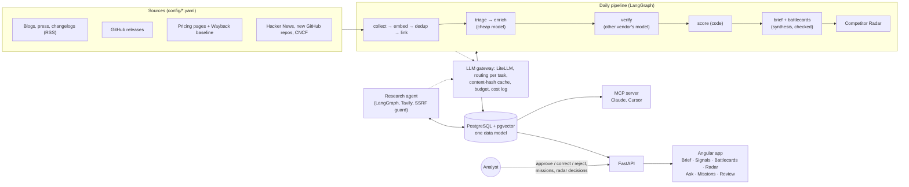

# FrogRadar

**What changed in JFrog's market since yesterday, and what it means for JFrog, with a checked source behind
every claim.**

FrogRadar is a competitive-intelligence system for JFrog's CI team. Every day it reads what competitors publish
(blogs, changelogs, GitHub releases, pricing pages) and what the industry press reports. One model writes a short,
JFrog-focused analysis of each item, and a second model from another vendor checks it against the source. Everything
lands in one data model, which the team reads as a Morning Brief, battlecards, cited answers to their questions,
research missions that an agent runs for them, and an MCP server for Claude and Cursor.

**Why it matters to JFrog's CI team**
- **Less scanning, more deciding.** Dozens of sources become one ranked brief: a top story with *why it matters for
  JFrog* and a *suggested move*, plus the next developments, each tied to the JFrog product it affects.
- **It catches what has no press release.** Pricing pages are watched and diffed (with a Wayback Machine baseline),
  so "Sonatype raised Nexus Repository Cloud Pro from $1,620 to $1,950 a year" shows up the day the page changes.
- **Claims you can repeat to Sales.** Every sentence links to its source and passed a second-model check, or is
  labelled "Partly verified". No source, no claim.
- **Analysts stay in charge.** Approve / correct / reject, and corrections teach the pipeline (few-shot).
- **It looks beyond the configured list.** The Competitor Radar finds new players nobody configured (Hacker News,
  new GitHub repos, the CNCF landscape) and ranks them with a transparent score.

**Run it** (Docker with Compose ≥ 2.24, your Anthropic and OpenAI keys): [Quick start](#quick-start).


---

**Contents:** [Quick start](#quick-start) · [Architecture](#architecture) · [Feature tour](#feature-tour) ·
[How accuracy is ensured](#how-accuracy-is-ensured) · [Evaluation](#evaluation-results) · [Cost](#cost-per-day) ·
[Dogfooding with JFrog](#dogfooding-we-build-and-scan-frogradar-with-jfrog) · [Now / Next](#now--next) ·
[Challenges](#challenges-and-pitfalls) · [Design decisions](#design-decisions) · [Security](#security-notes) ·
[Known limitations](#known-limitations) · [Stage 2](#stage-2-jfrog-security-task) · [Docs](#more-documentation)

## Quick start

You need Docker with Compose ≥ 2.24, an **Anthropic** key and an **OpenAI** key (`TAVILY_API_KEY` is optional).

```bash
git clone https://github.com/LidanAvisar/frogradar.git && cd frogradar
cp .env.example .env   # add ANTHROPIC_API_KEY and OPENAI_API_KEY (optional: TAVILY_API_KEY, GITHUB_TOKEN)
make up                # Postgres + backend + web app → http://localhost:8080 (first build takes a few minutes)
make seed              # optional: load the intelligence collected so far (up to 21 Oct 2026), no LLM calls
# open http://localhost:8080
make pipeline          # today's news: collect → enrich → verify → brief → battlecards → radar (paid)
make scheduler-up      # daily updates: the same run every day at 06:00 UTC (DAILY_RUN_CRON in .env)
```

- **Keys:** `make up` checks the two required keys first and stops with one message naming a missing key and
  where to put it (`.env`). A missing optional key turns off only its feature, and the UI says so: without
  `TAVILY_API_KEY`, research missions search FrogRadar's own data only; without `GITHUB_TOKEN`, GitHub is limited
  to 60 requests/hour. Key values are never logged, returned by the API or sent to the web app.
- **Seed:** `make seed` loads the committed intelligence (signals, battlecards, the radar, two finished missions,
  past Ask conversations) as normal data, so every screen has content before the first pipeline run. It only loads
  into a fresh database.
- **Older data:** the app uses the real date. When nothing is newer than the last 7 days (for example only the
  seed), the Brief shows the latest available day under the header *LATEST INTELLIGENCE · WEDNESDAY · 21 OCTOBER
  2026* with the note *"Nothing newer yet: this is the latest available day (21 Oct 2026). Run the pipeline (make
  pipeline) for today's news, or make scheduler-up for daily updates."* "Since yesterday" becomes "On 21 Oct
  2026", and the top story is that day's.
- **Daily updates** are the point of FrogRadar, and they cost money, so they're opt-in: `make scheduler-up` starts
  the scheduler, `make scheduler-down` stops it. `make down` stops everything; `make status` shows keys, features
  and today's spend.

| Paid action | Estimated cost | Guard |
|---|---|---|
| First pipeline run (fills a fresh or seeded database; depends on how many items the feeds still list) | ≈ $0.25–0.60 | daily budget |
| Each daily run after that (`make scheduler-up`) | ≈ $0.08 a day (≈ $2.50 a month) | daily budget |
| A new Ask question | ≈ $0.02 (answer + second-model check; repeats are cached, $0) | daily budget |
| A research mission | ≈ $0.03 | per-mission budget (default $0.30) + step and time limits |

Estimates are averages of the 2,350 logged calls of this project (per operation: triage $0.0003, enrich + verify
$0.0033, battlecard + check $0.048, daily brief + check $0.025). `LLM_DAILY_BUDGET_USD` (default $2) is a hard cap
per UTC day, checked before every paid call; the UI shows today's spend next to it. **One provider only?** Route
every tier to it with the `LLM_MODEL_*` overrides (see `.env.example`); because the verifier is then the same model
family as the writer, FrogRadar starts only with `ALLOW_SAME_FAMILY_VERIFY=true` and warns that accuracy checks are
weaker.

Commands, configuration, the data model and development setup: [docs/OPERATIONS.md](docs/OPERATIONS.md).

## Architecture



- **One data model, many lenses:** entities, sources, signals (summary, *why JFrog cares*, impact, confidence,
  evidence quote, embedding), feedback, missions, reports, the capability matrix and radar candidates. Every screen,
  the MCP server and the evaluation read the same tables.
- **Stack:** Python 3.12 (uv), FastAPI, SQLAlchemy 2 + Alembic, PostgreSQL 16 + pgvector, LangGraph, LiteLLM;
  Angular 18 (standalone components, signals, generated API types); Docker Compose; GitHub Actions + JFrog CLI.
- **Models (configurable per task in `config/llm_routing.yaml`):** Claude Haiku 5.5 for bulk triage / enrichment,
  Claude Sonnet 5.5 for synthesis and answers, GPT-5.4-mini to verify (a different vendor than both writers),
  `text-embedding-3-small` for embeddings.
- **Configuration, not code:** 13 competitors (plus JFrog), 47 sources, 39 capabilities and the model routing live
  in YAML. Adding a competitor is one block in `config/competitors.yaml` and `make seed`.

Pipeline internals: [docs/PIPELINE.md](docs/PIPELINE.md).

## Feature tour

Screenshots are from a seeded app (`make up` + `make seed`). More detail, the API and phone screenshots:
[docs/FEATURES.md](docs/FEATURES.md).

### Morning Brief


Stat tiles (new since yesterday, high impact, price changes), **one top story** – what happened, why it matters for
JFrog, a suggested move, each line with numbered source links – then the next developments as takeaway-first cards,
the pricing watch (was → now), what's new on the radar and the last pipeline run. "Executive view" keeps only the
tiles and the top story. [More](docs/FEATURES.md#morning-brief-and-the-read-api)

### Competitor Radar


New players found outside the configured list, ranked by an emergence score computed in code (relevance to JFrog
first, then credibility-weighted mentions, source diversity, velocity, traction, recency), with the breakdown shown.
Each profile statement cites its signals and is checked by the verify model. Nothing becomes a tracked competitor
unless an analyst approves it. [More](docs/PIPELINE.md#competitor-radar-players-nobody-configured)

### Battlecards and capability matrix


Per competitor: positioning, strengths, weaknesses, opportunities and blind spots for JFrog, each cited; a
capability matrix of JFrog (levels from config, each with a JFrog doc link) against the competitor (levels only with
an evidence signal); a timeline. A cell without evidence has an **Investigate** button that starts a research
mission. [More](docs/FEATURES.md#signals-battlecard-and-radar-pages)

### Ask your intelligence


Plain-language questions answered only from FrogRadar's own signals, battlecards and radar profiles: hybrid
retrieval (pgvector + full text, fused), company and time filters applied in code, every point cited and checked by
a second model, or an honest "not enough evidence" with what to track. [More](docs/FEATURES.md#ask-your-intelligence)

### Research missions


An analyst assigns the agent a question ("Does Sonatype offer reachability analysis?"). The agent plans, the analyst
approves the plan, the agent searches the web and FrogRadar, reads pages politely, extracts findings with exact
quotes (checked in code), and a second model verifies each one. Hard budget, step and time limits. Approved findings
become signals and update battlecards and radar profiles. [More](docs/FEATURES.md#research-missions)

### Review queue: analysts in the loop


Approve (A), correct (C) or reject (R) with keyboard shortcuts. A correction replaces what everyone sees (the
model's output is kept), and becomes a few-shot example for the most similar future signals. The AI vs Analyst
scorecard tracks how often the model was right, per field. [More](docs/FEATURES.md#analyst-in-the-loop-review-corrections-few-shot)

### MCP server and Skill


Seven tools (`whats_new`, `search_intel`, `get_signal`, `get_battlecard`, `pricing_changes`, `radar`, `ask`),
two resources and two prompts, over stdio or token-gated HTTP. Built on the same queries as the app, capped in size,
every item with its source URL, never the collected article text. A Skill teaches Claude the CI team's workflows
(morning brief, call prep, "is this new tool a threat?"). [More](docs/FEATURES.md#mcp-server-and-skill-frogradar-in-claude-cursor-and-other-mcp-clients)

### System status


Which keys are present (never their values), which features are on, degraded or off and why, today's spend
against the daily budget, and what each paid action costs.

## How accuracy is ensured

Every layer assumes the model can be wrong and checks it in code or with a second model:

| Layer | Check |
|---|---|
| Evidence quote | Must appear **verbatim** in the source text (checked in code; one retry; a near miss is repaired only with identical numbers). Unverified quotes are never shown as quotes. |
| Summary and *why JFrog cares* | Verified against the source by a model from **another vendor** (supported / partial / unsupported). Unsupported summaries are hidden. |
| Confidence | Computed **in code**, never by a model: 0.45 verification + 0.25 source trust + 0.15 corroboration + 0.15 quote check, with caps. Vendor marketing is labelled "vendor claim" separately. |
| Brief, battlecards, Ask, radar profiles, mission findings | Every sentence cites ids; one invalid citation drops the sentence; the verify model keeps only supported items (radar and missions keep partial ones, labelled "Partly verified"). Items are re-checked at read time and hidden when a cited signal stops being usable. |
| Prices | Shown as was → now only when both prices are in the right side of the same diff hunk with the same billing unit; otherwise the summary and the verified quote. |
| Entities and capabilities | Only known slugs (schema-validated); rule-based links confirmed by the model. JFrog's own levels come from config with doc links, never from a model. |
| Prompt injection | Source text sits in a block tagged with its own hash; instructions in it are never followed; and all checks above hold even if a model obeys an injection (tested). |
| Humans | Analyst corrections override the model, are kept as gold labels and as few-shot examples. |

## Evaluation results

Measured on a stratified 40-signal set and 40 dedup pairs with **silver labels** from a stronger model (agreement
with a model, not human-verified accuracy; details and limits in [docs/EVALUATION.md](docs/EVALUATION.md)):

| Metric | Result |
|---|---|
| Triage recall / precision | **100%** / 63% (tuned for recall: a missed signal costs more than an extra one) |
| Category agreement | 68% (feature update vs product launch is the main disagreement) |
| Impact exact / within ±1 | 64% / **100%** |
| Primary company | 86% strict, 100% counting product ↔ parent company |
| Evidence quotes verbatim | 97% (34 of 35) |
| Dedup threshold 0.85 (calibrated) | precision 100%, recall 33% (a missed merge is cheaper than hiding a competitor's launch) |
| Verifier "thinking" A/B | thinking off: 9–11% partial vs 51% with "low", same factual catches, 56% cheaper, 2× faster |

**Ask** (12 questions written from the data, [docs/FEATURES.md](docs/FEATURES.md#ask-your-intelligence)): mean
recall@8 **0.92**, the answer cites an expected document 10 of 10 times, "not enough evidence" 2 of 2 for questions
the data can't answer, $0.211 for all 12.

**Learning from analysts:** one correction (impact 2 → 1, "routine runner image updates don't affect JFrog
products") changed the model's impact for its nearest neighbour from 2 to 1, quoting the analyst's rule; without the
example it stayed 2. Analyst reviews export as gold labels (`make eval-gold`).

## Cost per day

| | Cost |
|---|---|
| Daily pipeline on the active sources (≈ 5 news items, ≈ 15 discovery items, brief, battlecards weekly) | **≈ $0.08** |
| A new Ask question / a research mission | ≈ $0.02 / ≈ $0.03 |
| Full re-enrichment and re-verification of all 32 in-scope signals + brief + 2 battlecards (run 33) | $0.22 once |
| Silver-label evaluation (labels + eval pass) | $0.93 once |

Every call is logged with tokens, cost and latency (`llm_calls`); identical calls are served from a content-hash
cache at $0. Bulk work runs on the cheapest tier; only synthesis uses Sonnet.

## Dogfooding: we build and scan FrogRadar with JFrog

FrogRadar analyzes the software supply-chain market, so it is built and scanned with the product it analyzes.

**CI ([`.github/workflows/jfrog.yml`](.github/workflows/jfrog.yml)):** on every push to `main`, GitHub Actions
authenticates to the JFrog Platform with **OIDC** (no stored credentials), builds the backend and web images, pushes
them to Artifactory, records both in **Build Info** `frogradar` with the Git and environment details, publishes it
and runs an **Xray build scan**. Actions are pinned to commit SHAs of releases at least 14 days old.

**`jf audit` with contextual analysis on FrogRadar itself (22 Oct 2026):**

| Scope | Result |
|---|---|
| Backend (Python, 119 runtime packages exported from `uv.lock`) | **13 CVEs, all in `filelock` 3.32.7** (transitive: litellm → huggingface-hub), 1 High, 9 Medium, 3 Low. Every one needs a *second local user* on the same host (AV:L); the container runs one non-root user, and nothing we install uses the vulnerable `ReadWriteLock`. The fix (4.2.1) is 5 days old, inside our 14-day supply-chain cooldown: upgrade on 31 Oct. Secrets: 0. IaC: 0. SAST: 12 Low (CLI error messages, one regex). |
| Frontend (npm) | 84 findings, most in **build tooling** that never ships (Angular CLI, vite, webpack-dev-server, tar…). The runtime Angular 18.2.14 packages carry 4 Critical/High XSS CVEs in the **i18n** and SVG `<script>` paths: contextual analysis marks the rest Not Applicable, and we checked that FrogRadar uses no i18n, no SVG scripts, no SSR / hydration and no XSRF config. The fix is an upgrade to Angular 20.3+ (Angular 18 is out of support): on the Next list. Secrets: 0. SAST: 0. |

**Latest green run (#5, 22 Oct 2026):** OIDC login → both images pushed to `docker-trial`
(`frogradar-backend`, `frogradar-web`, tag `<commit>-<run>.<attempt>`, never overwritten) → Build Info `frogradar/5`
with both images, Git and environment → Xray build scan. **0 policy violations** (security, license, operational
risk) – no Xray watch or policy is defined yet, so that is not a gate. The vulnerability list (`--vuln`) is the
useful part, and it points at the **base images**, not FrogRadar's code:

| Image (base) | Unique CVEs | Where |
|---|---|---|
| `frogradar-web` (nginx-unprivileged 1.29.3, Alpine 3.22) | 218: 15 Critical, 89 High | OpenSSL 3.5.4, curl / libcurl 8.14.1, nginx 1.29.3, expat, libxml2. The image only serves static files and proxies `/api`; curl isn't used at runtime. |
| `frogradar-backend` (python:3.12-slim, Debian 12) | 140: 3 Critical, 25 High | glibc, SQLite, zlib, util-linux from Debian; at the Python level only `filelock` (13, see above) and the base image's own `pip` 25.0.1 (7), which the app never runs. |

Next: move to newer base images (a current nginx-unprivileged Alpine and a Debian 13 slim Python), drop `pip` and
`curl` from the runtime images, then add an Xray watch + policy so the build scan fails on new Critical issues.

Setup notes for this platform: the build permission needs the pattern `frogradar/**` (build info is stored as
`frogradar/<number>-<timestamp>.json`), and the build must be indexed by name with Xray's v2 API
(`PUT /xray/api/v2/binMgr/builds` with `{build_name, build_repo}`); a v1 name list or an include pattern was
accepted but did not index it on Xray 3.157.

## Now / Next

| Area | Now | Next |
|---|---|---|
| Sources | 3 news sources + 2 pricing pages active (47 configured), plus HN / GitHub / CNCF discovery | Enable the full catalog; G2 reviews, earnings calls, job postings |
| Intelligence | Daily brief, battlecards + capability matrix, Competitor Radar, research missions | Predict the next move, "time machine" (state of a competitor on a date), insight fusion across signals |
| Analysts | Review queue, corrections as few-shot examples, AI vs Analyst scorecard | SSO and roles, undo, re-enrich neighbours of a new correction |
| Delivery | Web app, MCP server + Skill | Slack digest and bot, sales-ready battlecard export |
| Platform | Docker Compose with one `make up`, optional seed data, JFrog CI with OIDC, Build Info and Xray build scan | Kubernetes (Helm) deployment from Artifactory, mission worker as its own service with resume |
| Hardening | Supply-chain cooldown, SSRF guard, budget guards, Xray build scan in CI | Newer base images (most image CVEs), Angular 20+ upgrade, filelock 4.2.1, DNS pinning in the SSRF guard, Xray policy as a CI gate |

## Challenges and pitfalls

- **A second model checking the first is not deterministic.** Re-checking the same evidence can flip a borderline
  verdict; stability comes from the content-hash cache, not from sampling settings (temperature is silently dropped
  for Claude Haiku 5.5).
- **More verifier "thinking" made it worse.** With reasoning on, the verifier judged the JFrog-side analysis it was
  told to skip (51% partial); with it off it followed the rule and caught the same facts.
- **Models read a comparison row as a price change** ("$4 per user/month $21 per user/month" became "$4 → $21" for
  writer *and* verifier). Diff text now labels unchanged context, and prices are paired in code.
- **Vendor redesigns break page structure silently.** A live page where none of the configured sections match now
  fails the source instead of producing a misleading diff.
- **Approximate vector search broke cached answers on a copy of the data.** HNSW results differed between the dev
  database and a restored copy, so a repeated question missed its cached answer. Ask retrieval is now exact and
  deterministic.
- **Hidden reasoning tokens count against `max_tokens`** and cut outputs off; reasoning is now set explicitly per
  task and logged.

All pitfalls: [docs/DESIGN.md](docs/DESIGN.md#pitfalls-learned-the-hard-way).

## Design decisions

The ones that shape the product (all 83, D1–D83, each with what we rejected: [docs/DESIGN.md](docs/DESIGN.md)):

- **The LLM proposes, code verifies.** Quotes, citations, prices, entity slugs and confidence are checked or computed
  in code; a model from another vendor checks the claims.
- **One data model, many lenses.** Brief, battlecards, Ask, radar, missions, MCP and the eval read the same tables;
  no feature has its own copy of the truth.
- **Triage favours recall**; dedup favours precision (a duplicate shown twice is cheaper than a hidden launch).
- **Collected text is analysis input only.** Users see a summary, a short quote and the link; `raw_text` never
  leaves the server (tested on every endpoint and MCP tool) and is stripped from the seed data.
- **Missions have a plan gate and hard limits** instead of an open-ended tool-calling loop. Approved findings are
  intelligence, not news: they feed battlecards, Ask and the signal feed but never rank in the Brief, and a finding
  that repeats an existing signal is linked to it instead of duplicated.
- **Discovery is conservative:** nothing becomes a tracked competitor without an analyst; the radar score is a
  transparent formula, not an LLM "threat score".
- **Everything configurable, nothing hidden:** competitors, sources, capabilities, model routing, score weights and
  thresholds in YAML; every LLM call logged with its prompt version and cost.
- **One mode, bring your own keys:** `make up` checks the two required keys and names a missing one; optional
  keys only switch their feature off; `make seed` loads real intelligence without model calls, and the Brief says
  when it shows an older day instead of pretending it's today.

## Security notes

- **Secrets** only in `.env` (gitignored); `.env.example` lists names. Keys are scrubbed from errors, never logged,
  and the status endpoint reports only whether a key is present.
- **Collected text** (`raw_text`, mission page excerpts) never leaves the server; tests check every endpoint and MCP
  tool with a sentinel string.
- **Prompt injection:** hash-tagged delimiters, a never-follow rule, schema-validated output and code checks that
  hold even if a model obeys injected text.
- **SSRF guard for research missions:** http/https on ports 80/443 only, every resolved address must be public, checked
  on the page, its robots.txt and every redirect; size, time and content-type caps.
- **Good citizenship:** robots.txt, per-host delays, an identifying User-Agent, no logins, no paywall bypassing, no
  imitation of browser fingerprints.
- **MCP over HTTP** is off unless `MCP_TOKEN` is set (Bearer token, constant-time compare, Host allow-list).
- **Supply chain:** `uv.lock` with hashes, a 14-day cooldown on new releases (Python packages and GitHub Actions),
  LiteLLM's compromised versions excluded, non-root containers, unprivileged nginx, and the JFrog scans above.

## Known limitations

- **No authentication yet:** the analyst name is self-declared; write endpoints are open (local deployment only).
- **Seeded rows have no full text:** the seed carries summaries, quotes and links but not article text, so the
  pipeline never re-processes them; Ask and battlecards use their enrichment as usual.
- **Small corpus:** the active scope has 3 news sources and 2 pricing pages (43 signals shown), so Ask recall numbers are about
  ranking, not scale; the eval uses silver labels from one model.
- **Verifier strictness:** radar profile statements often come back "Partly verified"; a "what it means for JFrog"
  line can still predict a competitor's behaviour despite the prompt rule.
- **Missions:** one in-process worker, no resume after a restart; duplicates removed within one sub-question only;
  the SSRF guard resolves DNS separately from the HTTP client (DNS rebinding).
- **Frontend on Angular 18** (out of support) and **older base images** (most of the Xray build-scan CVEs); see
  Dogfooding above.

## Stage 2: JFrog security task

The JFrog Platform part of the assignment (scan, contextual analysis, two applicable vulnerabilities, a fix, Docker
and Build Info): [LidanAvisar/jfrog_task – docs/STAGE2.md](https://github.com/LidanAvisar/jfrog_task/blob/main/docs/STAGE2.md).

## More documentation

| Document | What's in it |
|---|---|
| [docs/OPERATIONS.md](docs/OPERATIONS.md) | All `make` commands, configuration files, data model, source scope, scheduler, LLM gateway, seed data maintenance, development setup |
| [docs/PIPELINE.md](docs/PIPELINE.md) | Collectors, page diffs and the Wayback baseline, dedup and entity linking, triage / enrich / verify / confidence, synthesis, Competitor Radar |
| [docs/FEATURES.md](docs/FEATURES.md) | Every screen and its API, analyst loop, Ask, research missions (with two paid runs), MCP server and Skill setup |
| [docs/EVALUATION.md](docs/EVALUATION.md) | Eval set, silver labels, results v1 → v2, limits, gold labels |
| [docs/DESIGN.md](docs/DESIGN.md) | Design decisions D1–D83 and the full pitfalls list |

```
backend/   FastAPI app (api, core, db, pipeline, agents, rag, mcp, seed) + tests
frontend/  Angular app + nginx image
config/    competitors, sources, capabilities, model routing, pipeline, discovery (YAML)
eval/      eval set and dedup pairs (ids, titles, URLs, labels; no article text) + results
skills/    the FrogRadar CI-analyst Skill
docs/      the documents above + screenshots
```
