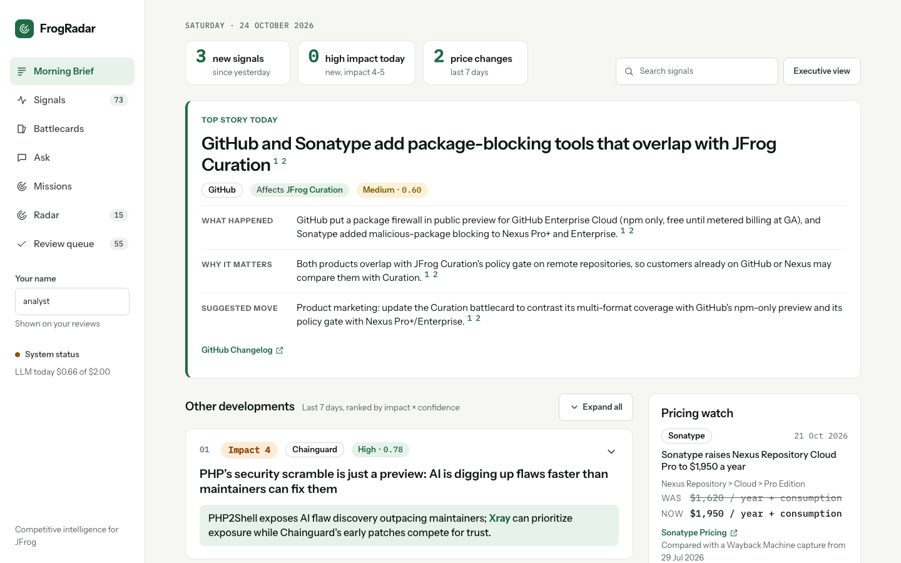
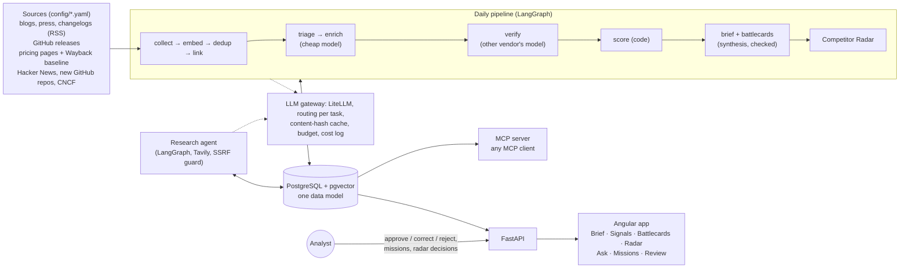
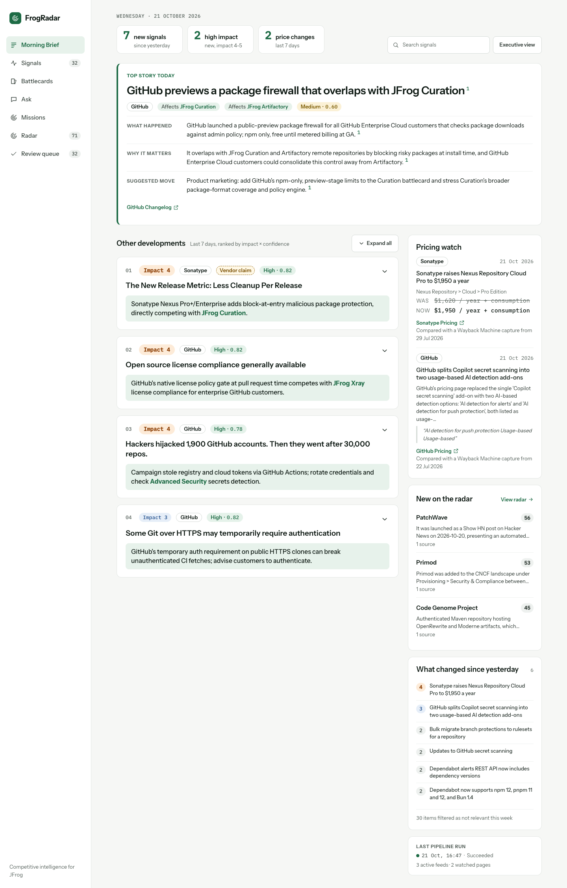
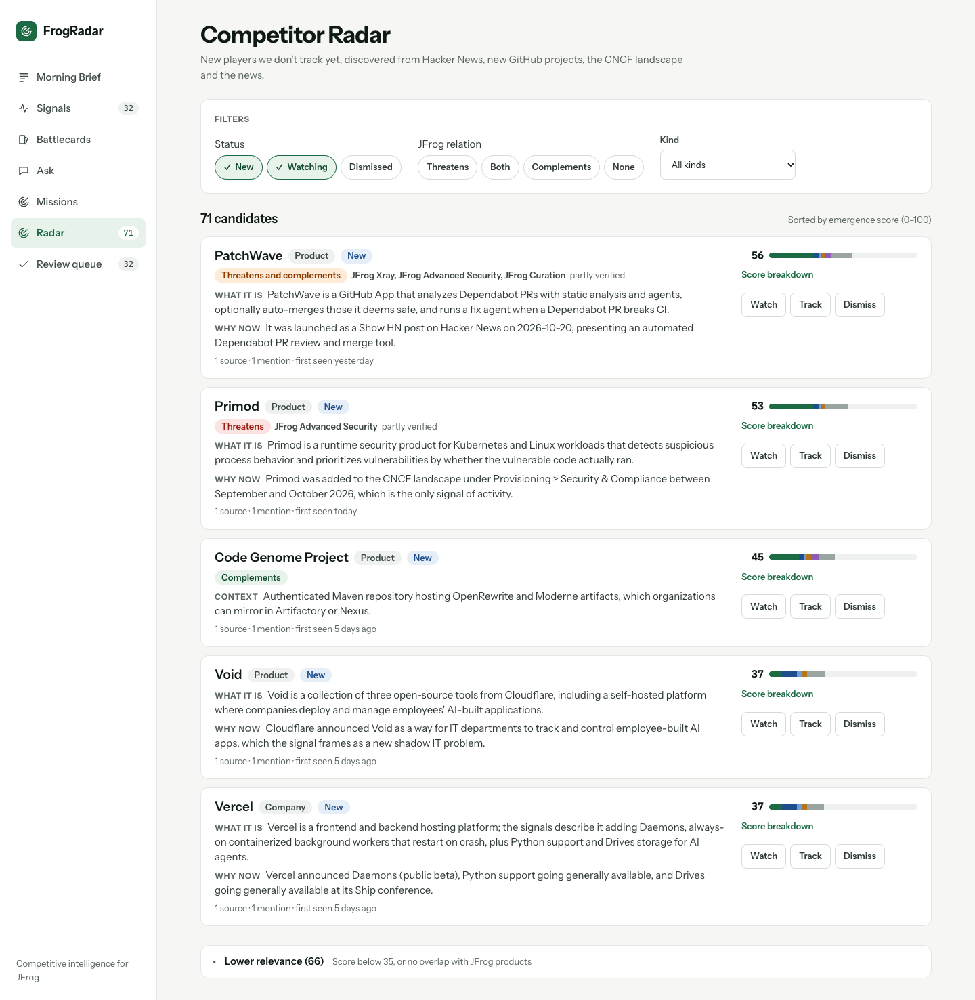
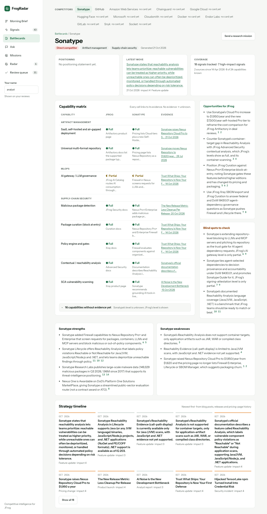
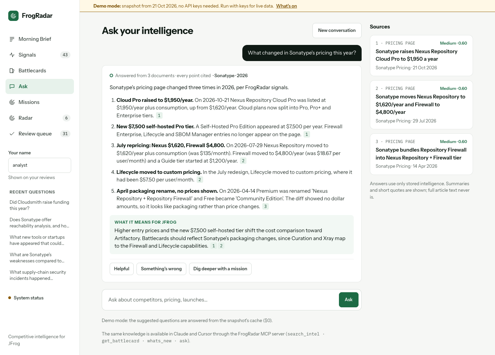
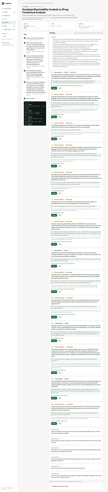
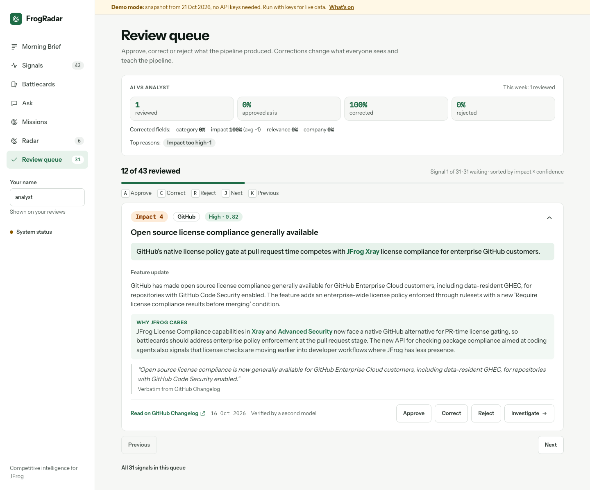
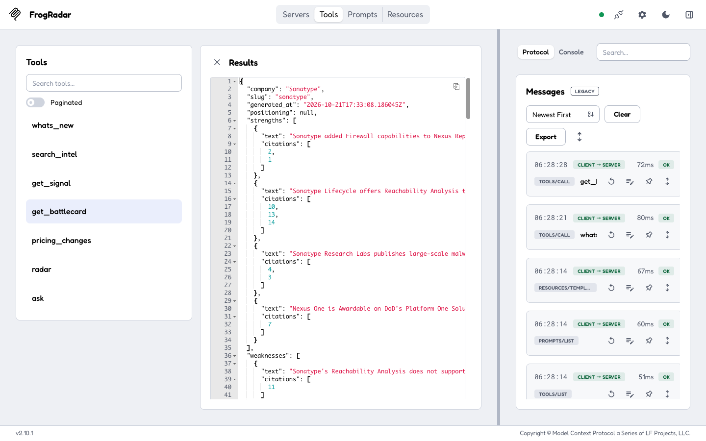
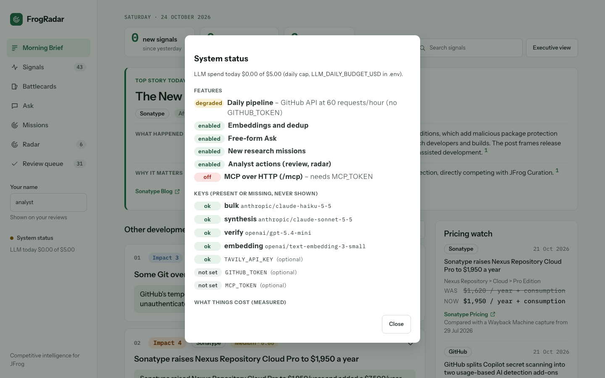

# FrogRadar

**JFrog's daily competitive-intelligence analyst, with every claim checked against its source.**

FrogRadar keeps JFrog's competitive-intelligence team up to date every day. It collects what competitors publish
(blogs, changelogs, GitHub releases, pricing pages) and what the industry press reports. One model writes a short,
JFrog-focused analysis of each item; a model from another vendor checks it against the source, and code checks
quotes, citations, prices and confidence. The team reads the result as a Morning Brief, battlecards with a capability
matrix, cited answers to questions, research missions run by an agent, and an MCP server for any MCP client (e.g.
Claude Desktop).

▶ **Video walkthrough (3–4 min):** https://canva.link/9tsroso8566xiiy



**Why it matters to JFrog's CI team**
- **One ranked brief instead of dozens of sources:** a top story with why it matters for JFrog and a suggested move.
- **Moves with no press release:** pricing-page diffs caught Sonatype raising Nexus Repository Cloud Pro from $1,620 to $1,950 a year.
- **Claims you can repeat to Sales:** every sentence links to its source and passed a second-model check, or says "Partly verified".
- **Players nobody configured:** the Competitor Radar finds new ones on Hacker News, GitHub and the CNCF landscape.

## How this meets the brief

| Requirement | How FrogRadar does it | Where |
|---|---|---|
| Keep the CI team updated daily | A LangGraph pipeline (collect → dedup → triage → enrich → verify → brief → battlecards → radar) runs daily with `make scheduler-up`; the Morning Brief shows what changed | [Quick start](#quick-start), [Architecture](#architecture) |
| Compare JFrog to its competitors | A battlecard for each competitor with enough evidence (5+ signals about it; Sonatype and GitHub today), a capability matrix over 39 capabilities and a timeline for every competitor, a pricing watch and the Competitor Radar | [Feature tour](#feature-tour) |
| Accurate | Verbatim quotes and citations checked in code, a verifier from another vendor, confidence computed in code, analyst corrections | [Accuracy](#how-accuracy-is-ensured), [Evaluation](#evaluation-results) |
| Scalable | Sources and competitors in YAML, cheap triage before costly steps, a content-hash cache, hard budgets, pgvector indexes | [Scalability](#scalability) |
| Runnable | `make up` with two API keys, optional seed data, images built and scanned with JFrog in CI | [Quick start](#quick-start), [Dogfooding](#dogfooding-built-and-scanned-with-jfrog) |
| Now / Next | What runs today and what comes next, per area | [Now / Next](#now--next) |
| Pitfalls | What went wrong and how it was fixed | [Challenges and pitfalls](#challenges-and-pitfalls) |

## Quick start

You need Docker with Compose ≥ 2.24, an **Anthropic** key and an **OpenAI** key (`TAVILY_API_KEY` is optional).

```bash
git clone https://github.com/LidanAvisar/frogradar.git && cd frogradar
cp .env.example .env   # add ANTHROPIC_API_KEY and OPENAI_API_KEY (optional: TAVILY_API_KEY, GITHUB_TOKEN)
make up                # Postgres + backend + web app → http://localhost:8080 (first build takes a few minutes)
make seed              # optional: load the intelligence collected so far (up to 21 Oct 2026), no LLM calls
# open http://localhost:8080
make pipeline          # today's news: collect → enrich → verify → brief → battlecards → radar (paid)
make scheduler-up      # daily updates: the same run every day at 06:00 UTC (DAILY_RUN_CRON in .env)
```

| Paid action | Estimated cost | Guard |
|---|---|---|
| First pipeline run (fills a fresh or seeded database; depends on how many items the feeds still list) | ≈ $0.25–0.60 | daily budget |
| Each daily run after that (`make scheduler-up`) | ≈ $0.08 a day (≈ $2.50 a month) | daily budget |
| A new Ask question | ≈ $0.02 (answer + second-model check; repeats are cached, $0) | daily budget |
| A research mission | ≈ $0.03 | per-mission budget (default $0.30) + step and time limits |

Keys, seed, older data, scheduler, budgets, single provider: [docs/OPERATIONS.md](docs/OPERATIONS.md#running-frogradar).

## Architecture



- **One data model:** entities, sources, signals (summary, *why JFrog cares*, impact, confidence, evidence quote,
  embedding), feedback, missions, reports, the capability matrix and radar candidates; every screen reads it.
- **Stack:** Python 3.12, FastAPI, SQLAlchemy 2 + Alembic, PostgreSQL 16 + pgvector, LangGraph, LiteLLM; Angular 18;
  Docker Compose; GitHub Actions + JFrog CLI.
- **Models** (per task in `config/llm_routing.yaml`): Claude Haiku 5.5 (bulk), Claude Sonnet 5.5 (synthesis),
  GPT-5.4-mini (verify, another vendor), `text-embedding-3-small` (embeddings). Internals: [docs/PIPELINE.md](docs/PIPELINE.md).

## Feature tour

### Morning Brief
One **top story** (what happened, why it matters for JFrog, a suggested move, each line with its sources), the next
developments, the pricing watch (was → now) and new radar entries. [More](docs/FEATURES.md#morning-brief-and-the-read-api)



### Competitor Radar
New players outside the configured list, ranked by an emergence score computed in code; cited, verified profiles;
nothing is tracked without an analyst. [More](docs/PIPELINE.md#competitor-radar-players-nobody-configured)



### Battlecards and capability matrix
Strengths, weaknesses, opportunities and blind spots for JFrog, each cited, and a capability matrix (a competitor's
level only with an evidence signal; **Investigate** starts a mission). [More](docs/FEATURES.md#signals-battlecard-and-radar-pages)



### Ask your intelligence
Answers only from FrogRadar's own data (pgvector + full text), every point cited and checked by a second model, or
"not enough evidence". [More](docs/FEATURES.md#ask-your-intelligence)



### Research missions
The agent plans, the analyst approves, the agent searches the web and FrogRadar and extracts quoted findings that a
second model verifies, within hard budget, step and time limits. [More](docs/FEATURES.md#research-missions)



### Review queue
Approve, correct or reject; a correction replaces what everyone sees and becomes a few-shot example for similar
signals. [More](docs/FEATURES.md#analyst-in-the-loop-review-corrections-few-shot)



### MCP server and Skill
Seven tools (`whats_new`, `search_intel`, `get_signal`, `get_battlecard`, `pricing_changes`, `radar`, `ask`) over
stdio or token-gated HTTP, plus a Skill for the CI team's workflows. [More](docs/FEATURES.md#mcp-server-and-skill-frogradar-in-any-mcp-client)



### System status
Which keys are present (never their values), which features are on, degraded or off and why, and today's spend
against the daily budget.



## How accuracy is ensured

Every layer assumes the model can be wrong and checks it in code or with a second model:

| Layer | Check |
|---|---|
| Evidence quote | Must appear **verbatim** in the source text (checked in code; one retry; a near miss is repaired only with identical numbers). Unverified quotes are never shown as quotes. |
| Summary and *why JFrog cares* | Verified against the source by a model from **another vendor** (supported / partial / unsupported). Unsupported summaries are hidden. |
| Confidence | Computed **in code**, never by a model: 0.45 verification + 0.25 source trust + 0.15 corroboration + 0.15 quote check, with caps. Vendor marketing is labelled "vendor claim" separately. |
| Brief, battlecards, Ask, radar profiles, mission findings | Every sentence cites ids; one invalid citation drops the sentence; the verify model keeps only supported items (radar and missions keep partial ones, labelled "Partly verified"). Items are re-checked at read time and hidden when a cited signal stops being usable. |
| Prices | Shown as was → now only when both prices are in the right side of the same diff hunk with the same billing unit; otherwise the summary and the verified quote. |
| Entities and capabilities | Only known slugs (schema-validated); rule-based links confirmed by the model. JFrog's own levels come from config with doc links, never from a model. |
| Prompt injection | Source text sits in a block tagged with its own hash; instructions in it are never followed; and all checks above hold even if a model obeys an injection (tested). |
| Humans | Analyst corrections override the model, are kept as gold labels and as few-shot examples. |

## Scalability

What grows with more sources, and what keeps it in check (figures from `llm_calls` unless marked as an estimate):

- **Configuration, not code.** A source or competitor is a YAML block. The catalog holds 47 sources (20 RSS feeds,
  10 GitHub release feeds, 17 pricing pages) for 13 competitors and 39 capabilities; 5 sources are active.
- **Cheap steps first, pay once.** Exact duplicates are dropped by content hash before any model call; a triage call
  (average $0.00031) decides relevance before enrichment ($0.00112) and the other-vendor check ($0.00211); every
  validated output and embedding is cached by content hash, so a repeat costs $0.
- **Hard limits.** `LLM_DAILY_BUDGET_USD` (default $2) is checked before every paid call; at the cap the run skips the
  remaining LLM stages. Each mission has a budget (default $0.30), 4 steps per approved sub-question and a 10-minute limit.
- **Indexes:** HNSW (pgvector, cosine) on `signals.embedding` for dedup, GIN for full text; Ask uses exact search on
  purpose, so a question always retrieves the same documents.

**Estimate for the whole catalog (all 47 sources active):** ≈ $0.18 a day (≈ $5.50 a month), against an estimated
≈ $0.08 a day on the 5 active sources. Prices per call are measured (`llm_calls` averages); daily volumes are estimates.
**A measured catch-up run** (24 Oct 2026, 215 paid calls, 9.0 minutes, $0.34) was bigger than a normal day because it
came three days after the last collection: 36 news items and 29 discovery items at once, plus 4 battlecards ($0.11).

| Part | Volume (estimated) × price (measured) | Per day |
|---|---|---|
| News items | ≈ 8.1 items a day published by the 47 sources (counted 22 Aug – 21 Oct 2026) × (triage $0.00031 + 61% relevant × (enrich $0.00112 + verify $0.00211)) | ≈ $0.02 |
| Battlecards | 13 competitors refreshed weekly, assuming each reaches the 5-signal threshold × $0.061 per card incl. check (measured 24 Oct, 23–24 input signals; smaller cards cost less) | ≈ $0.11 |
| Daily brief | 1 brief + check ($0.026) | ≈ $0.03 |
| Discovery and radar | unchanged by the source count (estimated on the active sources) | ≈ $0.02 |

Pricing-page changes are rare (≈ $0.003 each). **Bottlenecks today:** sequential collection (1 s gap per host); one
pipeline run at a time (advisory lock) from one scheduler; missions run one at a time on one in-process worker with no
resume; Ask's exact search scans every in-scope signal. **Next:** parallel collectors, the mission worker as its own service with a queue and resume, approximate
search for Ask once the corpus grows, and a Kubernetes (Helm) deployment pulling the images from Artifactory.

## Evaluation results

Measured on a stratified 40-signal set and 40 dedup pairs with **silver labels** from a stronger model (agreement
with a model, not human-verified accuracy; details and limits in [docs/EVALUATION.md](docs/EVALUATION.md)):

| Metric | Result |
|---|---|
| Triage recall / precision | **100%** / 63% (tuned for recall: a missed signal costs more than an extra one) |
| Category agreement | 68% (feature update vs product launch is the main disagreement) |
| Impact exact / within ±1 | 64% / **100%** |
| Primary company | 86% strict, 100% counting product ↔ parent company |
| Evidence quotes verbatim | 97% (34 of 35) |
| Dedup threshold 0.85 (calibrated) | precision 100%, recall 33% (a missed merge is cheaper than hiding a competitor's launch) |

**Ask** (12 questions written from the data): mean recall@8 **0.92**, an expected document cited 10 of 10 times,
"not enough evidence" 2 of 2 for questions the data can't answer, $0.211 in total. **Learning from analysts:** one
correction (impact 2 → 1) changed the model's impact for its nearest neighbour from 2 to 1; without it, it stayed 2.

## Cost

| | Cost |
|---|---|
| Daily pipeline on the active sources (≈ 5 news items, ≈ 15 discovery items, brief, 2 battlecards weekly; estimated volume × measured prices) | ≈ $0.08 |
| Catch-up run after three days without collection (measured, 24 Oct 2026: 36 news + 29 discovery items, 4 battlecards) | $0.34 |
| A new Ask question (measured: 25 questions, $0.54) / a research mission (measured: two runs, $0.0296 and $0.0298) | ≈ $0.02 / ≈ $0.03 |
| Silver-label evaluation (labels + eval pass; measured) | $0.93 once |

Every call is logged with tokens, cost and latency (`llm_calls`); repeats cost $0. Whole catalog: [Scalability](#scalability).

## Dogfooding: built and scanned with JFrog

FrogRadar analyzes the software supply-chain market, so it is built and scanned with JFrog. On every push to `main`,
[GitHub Actions](.github/workflows/jfrog.yml) log in with **OIDC** (no stored credentials), push the backend and web
images to Artifactory with an immutable `<commit>-<run>.<attempt>` tag, publish **Build Info** and run an **Xray build scan**.

- **Build scan:** 0 policy violations (no Xray watch or policy yet, so not a gate). Run #5 showed the vulnerabilities
  were in the base images, so we fixed those: newer bases pinned by digest (each at least 14 days old), and the
  unused curl, pip and nginx modules removed (D85). Same `jf docker scan`, linux/amd64, 24 Oct 2026:

  | Image | Before: unique CVEs (Critical) | After |
  |---|---|---|
  | `frogradar-web` (nginx-unprivileged 1.29.3 → 1.31.5, Alpine 3.22 → 3.24) | 229 (17) | **6 (0)** |
  | `frogradar-backend` (python 3.12 slim, Debian 12 → 13) | 140 (3) | **95 (0)** |

  Remaining risk: web has 3 High (OpenSSL with no fix yet; zlib and pcre2 fixed in newer Alpine packages). Backend has
  82 Debian 13 CVEs (20 High, 13 with a Debian fix that arrives with the next base image after the cooldown, from
  4 Nov) and 13 in `filelock`, below.
- **`jf audit` with contextual analysis:** backend 13 CVEs, all in transitive `filelock` 3.32.7 and needing a second
  local user (fix 4.2.1 clears the cooldown on 31 Oct); frontend 4 Critical/High XSS CVEs in Angular 18 paths
  FrogRadar doesn't use (i18n, SVG). Secrets: 0.
- **Next:** filelock 4.2.1, Angular 20.3+, an Xray policy as a CI gate. Details: [docs/DOGFOODING.md](docs/DOGFOODING.md).

## Now / Next

| Area | Now | Next |
|---|---|---|
| Sources | 3 news sources + 2 pricing pages active (47 configured), plus HN / GitHub / CNCF discovery | Enable the full catalog; G2 reviews, earnings calls, job postings |
| Intelligence | Daily brief, battlecards + capability matrix, Competitor Radar, research missions | Predict the next move, "time machine" (state of a competitor on a date), insight fusion across signals; JFrog side of comparison missions answered from config/jfrog_capabilities.yaml (doc-linked) instead of web search |
| Analysts | Review queue, corrections as few-shot examples, AI vs Analyst scorecard | SSO and roles, undo, re-enrich neighbours of a new correction |
| Delivery | Web app, MCP server + Skill | Slack digest and bot, sales-ready battlecard export |
| Platform | Docker Compose with one `make up`, optional seed data, JFrog CI with OIDC, Build Info and Xray build scan | Kubernetes (Helm) deployment from Artifactory, mission worker as its own service with resume |
| Hardening | Supply-chain cooldown, SSRF guard, budget guards, Xray build scan in CI, base images pinned by digest with unused packages removed (0 Critical image CVEs) | Angular 20+ upgrade, filelock 4.2.1 (31 Oct), base-image refresh as fixes clear the cooldown, DNS pinning in the SSRF guard, Xray policy as a CI gate |

## Challenges and pitfalls

- **A second model checking the first is not deterministic;** stability comes from the content-hash cache, not
  sampling settings (temperature is silently dropped for Claude Haiku 5.5).
- **More verifier "thinking" made it worse.** With reasoning on, the verifier judged the JFrog-side analysis it was
  told to skip (51% partial); with it off it followed the rule and caught the same facts.
- **Models read a comparison row as a price change** ("$4 per user/month $21 per user/month" became "$4 → $21" for
  writer *and* verifier). Diff text now labels unchanged context, and prices are paired in code.
- **Approximate vector search differed on a copy of the data** and missed cached answers; Ask search is now exact.
- **Hidden reasoning tokens count against `max_tokens`** and cut outputs off; reasoning is set explicitly per task.
- **Vendor redesigns break page structure silently;** a page where no configured section matches now fails the source
  instead of producing a misleading diff.

All pitfalls: [docs/DESIGN.md](docs/DESIGN.md#pitfalls-learned-the-hard-way).

## Design decisions

The ones that shape the product (all 86, each with what was rejected: [docs/DESIGN.md](docs/DESIGN.md)):

- **The LLM proposes, code verifies.** Quotes, citations, prices, entity slugs and confidence are checked or computed
  in code; a model from another vendor checks the claims.
- **One data model, many lenses**; **triage favours recall, dedup favours precision** (a duplicate shown twice is
  cheaper than a hidden launch).
- **Collected text is analysis input only:** users see a summary, a quote and the link; `raw_text` never leaves the server.
- **Missions have a plan gate and hard limits**; **discovery is conservative** (no tracked competitor without an
  analyst; the radar score is a transparent formula, not an LLM "threat score").
- **One mode, your own keys:** a missing required key is named at start; optional keys only switch their feature off.

## Security notes

- **Secrets** only in `.env` (gitignored); key values are never logged or returned (tested), the status shows only
  present / missing.
- **Prompt injection:** hash-tagged delimiters, a never-follow rule, and code checks that hold even if a model obeys it.
- **SSRF guard for missions:** http/https on ports 80/443, public addresses only, checked on every redirect.
- **Good citizenship:** robots.txt, per-host delays, an identifying User-Agent, no logins or paywall bypassing.
  **MCP over HTTP** is off unless `MCP_TOKEN` is set (Bearer token, constant-time compare, Host allow-list).
- **Supply chain:** `uv.lock` with hashes, a 14-day cooldown on new releases, LiteLLM's compromised versions excluded,
  non-root containers, unprivileged nginx, and the JFrog scans above.

## Known limitations

- **No authentication yet:** the analyst name is self-declared; write endpoints are open (local deployment only).
- **Seeded rows have no full text**, so the pipeline never re-processes them (Ask and battlecards use their enrichment).
- **Small corpus:** 3 news sources and 2 pricing pages are active (43 visible signals in the seed), so Ask recall measures
  ranking, not scale; the eval uses silver labels from one model. Only Sonatype and GitHub reach the battlecard
  threshold because 5 of 47 sources are active; enabling more sources fills the rest.
- **Missions:** one in-process worker, no resume after a restart; the SSRF guard resolves DNS separately (rebinding).
- **Angular 18** (out of support) and `filelock` 3.32.7 (fix inside the 14-day cooldown until 31 Oct); the images still
  carry 88 non-Critical OS CVEs, most without a fix yet; see [Dogfooding](#dogfooding-built-and-scanned-with-jfrog).

## Stage 2: JFrog security task

The JFrog Platform part of the assignment (scan, contextual analysis, two applicable vulnerabilities, a fix, Docker
and Build Info): [LidanAvisar/jfrog_task – docs/STAGE2.md](https://github.com/LidanAvisar/jfrog_task/blob/main/docs/STAGE2.md).

## More documentation

| Document | What's in it |
|---|---|
| [docs/OPERATIONS.md](docs/OPERATIONS.md) | Running FrogRadar (keys, seed, older data, budgets), all `make` commands, configuration, data model, source scope, scheduler, LLM gateway, seed data maintenance, development setup |
| [docs/PIPELINE.md](docs/PIPELINE.md) | Collectors, page diffs and the Wayback baseline, dedup and entity linking, triage / enrich / verify / confidence, synthesis, Competitor Radar |
| [docs/FEATURES.md](docs/FEATURES.md) | Every screen and its API, analyst loop, Ask, research missions (with two paid runs), MCP server and Skill setup |
| [docs/EVALUATION.md](docs/EVALUATION.md) | Eval set, silver labels, results v1 → v2, limits, gold labels |
| [docs/DESIGN.md](docs/DESIGN.md) | Design decisions D1–D86 and the full pitfalls list |
| [docs/DOGFOODING.md](docs/DOGFOODING.md) | JFrog CI, `jf audit` and Xray build-scan results, platform setup notes |
