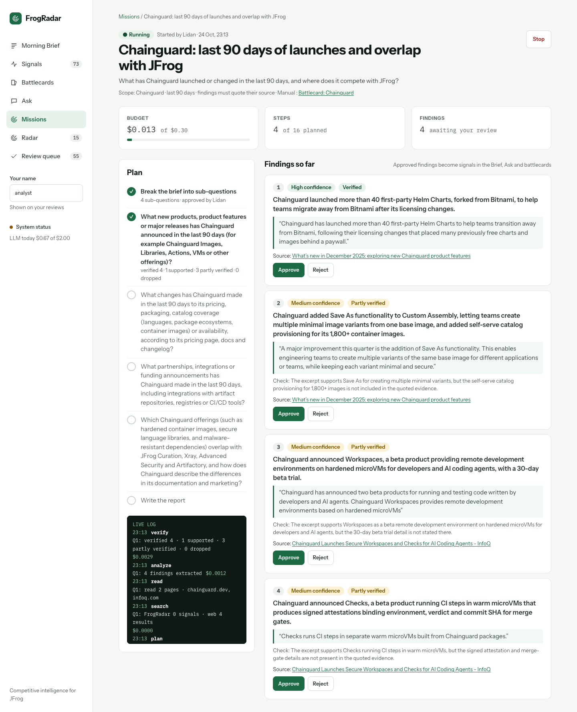

# Features in detail

<!-- Moved out of the README (S17). The README links here; keep both in sync. -->

Every screen and lens on the one data model, with its API, rules and measured runs.

## Morning Brief and the read API


The first screen (`/`) tells one story once:
- **Stat tiles:** new signals since yesterday, how many are high impact (4-5), price changes in the last 7 days;
  each opens the Signals list with that filter.
- **Top story today:** a plain-language title, then *What happened*, *Why it matters* (for JFrog) and a
  *Suggested move* for a JFrog team, each with numbered links to its sources, plus company, affected JFrog
  product and confidence. It comes from the daily brief; without one (or when its sources stop checking out) the
  top-ranked signal is shown instead (title, summary, takeaway, no suggested move).
- **Other developments:** the next 4 ranked signals (impact × confidence), without the top story's signals, as
  collapsible cards (takeaway first; expand for summary, "Why JFrog cares", evidence and actions).
- **Right rail:** pricing watch (old and new price on aligned lines), what else was published since yesterday,
  filtered count, last pipeline run.

"Executive view" shows only the tiles and the top story, remembered per browser. At phone width the sidebar becomes
a top bar with a Menu button and the rail drops below the cards ([390 px screenshot](screenshots/brief-390.png)).

Read API (FastAPI, `backend/app/api/`, OpenAPI at `/docs`):

| Endpoint | Returns |
|---|---|
| `GET /api/brief?days=7&limit=4` | stats, top story, other developments, since yesterday, filtered count, pricing watch, last run |
| `GET /api/signals` | filters `entity` (slug, a company includes its products), `category`, `min_impact`, `relevant`, `since`, `until`, `window` (`24h` / `7d` / `30d` / `90d`, server clock), `kind` (`article` / `page_diff`), `include_unsupported` (default false), `q` (full text), `page`, `page_size` |
| `GET /api/signals/{id}` | one signal |
| `GET /api/entities` | tracked companies with signal counts |
| `GET /api/nav` | sidebar counts |
| `POST /api/ask` | `{question, conversation_id?}` → cited answer points, what it means for JFrog, `not_enough_evidence`, 3 follow-ups, sources, retrieved count, cost |
| `GET /api/ask/conversations`, `/{id}` | recent analyst conversations (`source=ui` default; `eval`, `all`); one conversation's turns as shown |
| `POST /api/ask/turns/{id}/feedback` | Helpful / Something's wrong (reason + comment) → feedback row |
| `GET /api/battlecards` | tracked competitors for the switcher: those with a card first, then "no card yet" |
| `GET /api/entities/{slug}/battlecard` | latest battlecard, capability matrix (JFrog vs competitor, evidence link, changed-recently flag), timeline, coverage counts |
| `GET /api/self` | JFrog and its product names (from `competitors.yaml`) for highlighting |
| `POST /api/signals/{id}/approve` · `/correct` · `/reject` | analyst review: `{analyst, comment?}`; correct adds `reason_code` + only the changed `category` / `impact` / `relevant` / `primary_entity`; reject adds `reason_code`; 409 on a conflicting state → updated signal with `review` |
| `GET /api/review` | signals waiting for review (impact × confidence) + progress `{reviewed, total}` |
| `GET /api/feedback/scorecard` | AI vs Analyst: approved as is / corrected / rejected %, per-field correction rates (impact with mean delta), top reason codes, overall and per week |
| `GET /api/missions/prefill` | form defaults from `signal`, `candidate`, `entity` / `entity_slug` (+ `capability` / `capability_slug`) or `turn`: brief, origin, companies, budget and step defaults |
| `POST /api/missions`, `GET /api/missions`, `GET /api/missions/{id}` | create (the worker writes the plan); list (status, origin, cost, steps, findings to review); detail (plan, step log, verified findings with source link and quote, dropped reasons, report). Never the fetched page text |
| `POST /api/missions/{id}/plan`, `/stop` | approve the plan (optionally edited sub-questions) → research starts; stop (queued / awaiting: at once; running: after the current step) |
| `POST /api/missions/findings/{id}/approve`, `/reject` | approved finding → signal (or the existing FrogRadar signal it came from); reject (reason, comment) → feedback row |
| `POST /api/missions/{id}/refresh-radar` | rebuild a radar candidate's profile from its mentions incl. approved findings; returns relation / score / profile before and after |

Rules: only in-scope, canonical, enriched signals are returned; `raw_text` is never returned; a quote that was not
found verbatim in the source comes back with `verified: false` and the UI does not show it as a quote.

Frontend (`frontend/`, Angular 18): design tokens in `src/styles/tokens.css` (no other color literals,
`npm run lint:tokens`), shared components in `src/app/shared/`, API types generated from OpenAPI
(`make api-types`). Run it with `make up` and `cd frontend && npm start` (proxy to :8000), then open
http://localhost:4200. Frontend tests: `npm run test:ci` (headless Chrome).

## Signals, Battlecard and Radar pages

All three reuse the Brief's components and tokens; every claim links to its source signal.

- **Signals (`/signals`):** search, company, category, minimum impact, date window (24 hours / 7 / 30 / 90 days)
  and kind (articles / pricing pages). The URL query string holds every filter, so the Brief tiles open it
  pre-filtered (`?since=24h`, `?since=24h&min_impact=4`, `?kind=page_diff&since=7d`), links can be shared and Back
  restores the previous view. The window is computed on the server with the Brief's clock, and unsupported
  summaries are hidden by default as in the Brief stats, so a tile's number equals the list total (tested).
  
- **Battlecard (`/battlecards/:slug`; `/battlecards` opens the top competitor):** switcher (competitors without a
  card are marked "no card yet"), relationship and segments, three tiles (positioning, latest move = newest
  impact 4-5 signal, coverage), the capability matrix (JFrog level from config vs the competitor's level from
  evidence, each a symbol and a word, evidence link per cell, "Changed recently"; capabilities where the
  competitor's level is unknown are folded into "N capabilities without evidence yet", each with JFrog's level and
  an Investigate link that starts a research mission "Does <competitor> offer <capability>?"; scrolls inside its own box on phones), cited opportunities / blind spots / strengths / weaknesses with one
  numbering across the card, and the strategy timeline newest first.
  
- **Radar (`/radar`, `/radar/:id`):** candidates by emergence score with status / JFrog relation / kind filters
  (in the URL), "what it is" and "why now" from the verified profile, the relation chip with the JFrog products
  (marked "partly verified" when the verifier found the relation statement only partly supported), and the score as a number, a stacked bar (decorative) and the same
  breakdown as text. Candidates below `radar.ui.lower_relevance_below` (config/discovery.yaml, 35) or with relation
  "none" are collapsed under "Lower relevance (N)"; the Radar nav pill counts only new candidates in the top
  section (same rule, in SQL, tested against the list). The detail page shows the cited profile, mentions, metrics, the
  score explained per component, merges and other names. Watch / Track / Dismiss are optimistic (rolled back on
  error) and announced in a snackbar; Track and Dismiss open Material dialogs themed with the tokens (full width
  on phones). Investigate (radar) and "Send a research mission" (battlecard) open the mission form pre-filled.
  

Phone screenshots (390 px): [Radar](screenshots/radar-390.png), [Radar detail](screenshots/radar-detail-390.png),
[Battlecard](screenshots/battlecard-sonatype-390.png), [Signals](screenshots/signals-filtered-390.png);
desktop [Radar detail](screenshots/radar-detail-1440.png).

## Analyst in the loop: review, corrections, few-shot

Code: `backend/app/api/review.py`, `app/pipeline/fewshot.py`

Analysts judge what the AI produced. Their corrections change what everyone sees, teach the pipeline, and
measure how often analysts and the AI agree.

- **Actions** (Brief cards, Signals list, review queue): **Approve**, **Correct** and **Reject**.
  - Correct opens a dialog with category, impact 1-5, relevant yes / no, primary company, a reason code and an
    optional comment. Only changed fields are sent, and the reason is suggested from the change (impact down →
    "impact too high").
  - The correction replaces the shown values. The model's own values are kept in `meta.model_output`.
    Re-enrichment (e.g. a prompt bump) refreshes `model_output` and puts the analyst's values back, so nothing
    is lost either way.
  - Reject, or relevant = no, sets status rejected: the signal leaves the Brief, the lists, synthesis inputs and
    Ask (one filter in `scope.visible()`), and stays in the DB.
  - Every action writes a `feedback` row (target, action approve / edit / reject, `{field: {from, to}}`, reason,
    comment, analyst).
  - Cards show "Edited by analyst" (the fields in a tooltip and for screen readers) or "Approved".
  - The UI is optimistic: the card changes at once and rolls back on error, with snackbar announcements, the same
    pattern as the Radar.
  - No auth: the analyst name comes from the "Your name" field in the sidebar (stored per browser, default
    "analyst").
- **Review queue (`/review`):** signals with status new, sorted by impact × confidence, one in focus (takeaway,
  summary, why, verified quote, source link). Shortcuts: **A** approve, **C** correct, **R** reject, **J / K**
  next / previous. They are ignored while typing in a field, while a dialog is open, or with a modifier key.
  Progress shows "N of M reviewed", and the nav pill counts the waiting signals.
- **Learning from corrections (dynamic few-shot):**
  - For triage and enrich, the 3 most similar corrected signals are picked by pgvector cosine on the stored
    embeddings, with similarity ≥ 0.4.
  - Each is rendered into the prompt's `$examples` slot as "Model said: impact 2 / Analyst corrected to:
    impact 1 / Because: impact too high: <comment>".
  - Rejections as not relevant teach triage; category / impact / company corrections teach enrich.
  - Examples are capped per example (600 chars) and in total (1,800), and titles / excerpts are defanged
    (delimiter look-alikes, newlines).
  - The examples are part of the messages, so the LLM cache misses for the neighbours of a new correction and
    nothing else.
  - The eval runner never adds examples. Config: `config/pipeline.yaml` `fewshot:`.
- **AI vs Analyst scorecard:** a compact panel on top of `/review` (`GET /api/feedback/scorecard`). It shows
  reviewed count, approved as is / corrected / rejected %, correction rate per field (impact with the mean
  delta), top reason codes, and the same per ISO week.

**Learning from analysts – one example (S14, dev DB, $0.0040 in total).**
- An analyst corrected #80 "Xcode 27 runner image generally available" from impact 2 to 1. Reason:
  impact_too_high. Comment: "routine runner image updates don't affect JFrog products".
- Its nearest neighbour is #78 "CodeQL changes for macOS 27, Xcode 27, and Swift 6.4" (similarity 0.63). It was
  re-enriched twice with fresh calls (no cache, nothing stored): once without examples (control) and once with
  few-shot, whose examples section held exactly that correction.

| #78 | stored (original run) | few-shot off (control) | few-shot on |
|---|---|---|---|
| impact | 2 | 2 | **1** |
| impact rationale | "A tangential toolchain compatibility change in a partner's SAST tool with limited direct effect on JFrog's products." | "A tangential platform-specific limitation in a partner's scanner with limited effect on JFrog's core Artifactory, Xray or Curation business." | "Routine toolchain compatibility change in a competitor-coopetition tool with no effect on JFrog products." |
| primary entity | github | github-advanced-security | github-advanced-security |

What it shows:
- Without the example, the model rated #78 impact 2 twice. With it, the model rated 1, and its rationale
  repeats the analyst's rule ("routine … no effect on JFrog products").
- The entity change appears in the control too, so it is ordinary model variation, not learning.
- This is one item and one sample per condition. The bulk model is not deterministic (temperature is dropped
  for haiku-5-5), so it is an illustration, not a measurement. The scorecard and gold labels are where the effect
  can be measured over time.


Phone: [Review queue](screenshots/review-390.png), [card "Edited by analyst"](screenshots/signal-edited-390.png);
desktop [edited card](screenshots/signal-edited-1440.png).

## Ask your intelligence

Code: `backend/app/rag/`


Analysts ask in plain language; the answer comes only from stored intelligence, every point cited, or it says
there is not enough evidence ([390 px](screenshots/ask-390.png)).

- **Documents:** usable signals (articles and pricing diffs: title, takeaway, summary, why JFrog cares, verified
  quote; never `raw_text`), items of each competitor's latest battlecard whose cited signals are still usable, and
  accepted Competitor Radar profiles. Each has a typed id the model cites: `sig:1055`, `bc:sonatype:weaknesses:1`,
  `radar:158`.
- **Retrieval:** the question is embedded (gateway, cached); signals are ranked by pgvector cosine on their stored
  embedding and by `ts_rank` on `search_tsv` (OR of the question's lexemes); battlecard and radar texts the same
  way in code / one SQL statement. A third list holds signals of a category the question names ("incidents" →
  security incident) and battlecard items of a named section ("weaknesses"). Reciprocal rank fusion
  (1 / (60 + rank)) merges them; top 8 (cap 12), at most 3 battlecard items and 3 radar profiles.
- **Filters in code, not by the model:** one named company (products and aliases map to it; JFrog never filters)
  and a time window ("this week", "this month", "in October", "this year") become SQL conditions; battlecard items
  drop out of time-bounded questions, radar profiles out of company questions. The UI shows the filters used.
- **Follow-ups:** with earlier turns, the bulk model rewrites the question into a standalone one from the last 3
  turns (`ask_rewrite.v1`); the UI shows "Searched for: …".
- **Answer (`ask.v1`, synthesis model):** 2-6 points (bold lead + one or two sentences, 1-4 doc ids each), an
  optional "What it means for JFrog" (current portfolio only; discontinued products never suggested), 3 follow-ups,
  or `not_enough_evidence` with the gap and what to track / which mission to run. The question and the documents
  are separate delimited blocks; instructions inside them are never followed.
- **Checks (as in S10):** an item citing an id outside the retrieved set is dropped; `verify_ask.v1` (verify model,
  other provider) judges each item against its cited documents, with JFrog's portfolio and capability levels as
  trusted context; only `supported` is kept. Dropped items are stored with the turn, never returned. No point left
  → not enough evidence. No document at all → not enough evidence without any LLM call.
- **Conversations and cost:** `ask_conversations` (with `source`: ui, or eval for `make eval-ask` runs, which
  Recent questions and `GET /api/ask/conversations` leave out unless `?source=eval|all`) / `ask_turns` (migration 0011) keep each turn's standalone query,
  filters, retrieved ids with ranks, the answer as shown, dropped items and prompt versions. `llm_calls.ask_turn_id`
  gives the cost per turn; identical question + identical documents = identical messages = a cache hit ($0).
- **UI (`/ask`):** thread with question bubbles, answer cards with numbered citation chips (focus moves to the
  entry in the Sources rail: type, confidence, title link, source, date), follow-up chips, recent questions in the
  sidebar, `?c=<conversation>&t=<turn>` deep links, a live region announcing the answer, Helpful / Something's wrong
  (dialog with reason codes) and "Dig deeper with a mission" / "Send a research mission" (opens the mission form
  pre-filled with the question and the gap).

**Eval (2026-10-21, `eval/results/ask_20261021T150444Z.md`):** 12 questions written from the stored data, 2 the
data can't answer and 2 answered from radar / battlecard documents. Retrieval tuning (embeddings only) moved mean
recall@8 from 0.65 to 0.92 (per-type cap, category / section list, radar relation in the document text).

| | result |
|---|---|
| mean recall@8 (10 answerable) | 0.92; 8 of 10 at full recall (q08 misses the DoWI 8430.01 post for "US public sector", q12 one Sonatype pricing diff) |
| answer cites ≥ 1 expected document | 10 of 10 |
| not enough evidence when unanswerable | 2 of 2 (GitLab Ultimate price, Cloudsmith funding: no documents after the company filter, $0) |
| items dropped by the verifier | 4 in 2 answers (partial: an added detail or a JFrog-side claim) |
| cost | $0.211 for 12 questions (about $0.02 per answered question: Sonnet answer + gpt-5.4-mini check) |

Known limits: a "what it means" line can still predict a competitor's behaviour ("Expect Sonatype to cite…")
despite the prompt rule, and the verifier passed it; the corpus is small (32 signals), so recall numbers are
about ranking, not scale; recall@k is measured against ids chosen by one person.

## Research missions

Code: `backend/app/agents/mission/`



An analyst gives the agent a research task. The agent plans, the analyst approves the plan, the agent searches,
reads and extracts findings, a second model checks every finding against its source, and the analyst decides which
findings become intelligence.

- **Start:** `/missions` → New mission (brief, optional companies and time window, budget default $0.30, max
  steps default 12). Every Investigate / Send a research mission button opens the form pre-filled, and the origin
  is stored on the mission:
  - a signal card: "Investigate …: what changed, what is confirmed, what it means for JFrog";
  - a radar candidate: "What does <X> sell, and how does it overlap with JFrog's products?";
  - a battlecard cell without evidence: "Does <competitor> offer <capability>?"; the battlecard header: what changed
    in the last 90 days;
  - an Ask answer: the question and the gap FrogRadar couldn't answer.
- **Plan (`mission_plan.v1`, synthesis model):** 3-5 sub-questions, each with a web search query. The mission waits
  in `awaiting_approval`; the analyst edits, removes or adds sub-questions and approves. Nothing is searched before.
- **Research loop (LangGraph), per sub-question:**
  - **search:** FrogRadar's own knowledge (the Ask retrieval, signals only, scoped to the mission's companies and
    window) and Tavily web search (4 results);
  - **read:** the top 2 pages through the polite client (robots.txt, rate limit, SSRF guard, see Security notes),
    text/html only, trafilatura main text; login walls, paywalls and JS-only pages (too little text) are skipped
    and noted;
  - **extract (`mission_extract.v1`, bulk model):** findings, each citing one source with an exact quote. The quote
    is checked in code against the stored page text; an unknown source or a quote that isn't there drops the
    finding before any further cost;
  - **verify (`mission_verify.v1`, verify model, another provider):** each finding against its cited excerpt.
    Supported → shown as Verified. Partial → shown as **Partly verified** with the checker's note, confidence at most
    medium. Unsupported → dropped and recorded.
- **Report (`mission_report.v2`):** summary points that cite kept findings only (a point without a valid finding
  id is removed), plus open questions: unanswered sub-questions and what was not found. Partly verified findings
  reach the report with the checker's note and their unconfirmed detail must not be repeated (v2, after run (a)
  below repeated one). Absence of evidence is an open question, never a finding.
- **Limits:** every step writes a `mission_steps` row (kind, summary, cost). Before every counted step (search,
  read, extract, verify): the mission budget (also enforced by the gateway, `MissionBudgetExceeded`), the step
  limit (4 per sub-question of the approved plan, set at approval, capped at 40; D84), a 10-minute wall clock and
  the analyst's Stop. A limit jumps to the report, written without another LLM call; unverified findings are
  dropped. A mission that ends with sub-questions that never ran is shown as partial ("Completed – partial", or
  "Budget reached" / "Stopped" / "Failed" with "N of M sub-questions researched") and lists them as "Not
  researched". The plan-approval screen shows the steps and an estimated cost (report + per sub-question). Page text is always inside a hash-tagged delimiter with a never-follow rule.
- **Runs in the background:** one in-process worker thread started with the API. On startup, missions left in
  planning / running are marked failed ("interrupted by a server restart"); queued ones are picked up again.
- **Findings → intelligence:** Approve turns a finding into a signal (`mission_id`, source URL, statement as title,
  summary and takeaway, the checked quote, status approved, its verification, linked to the mission's company and
  capability, embedded) – the Brief, Signals, Ask and battlecards read it like any other. A finding from a FrogRadar
  signal links that signal instead of creating a copy. For a radar mission, approved findings join the candidate's
  mentions and **Refresh radar profile** rebuilds and re-scores it. Every review writes a feedback row.
- **UI (`/missions/:id`, docs/design Mission):** status with a live region, Stop, budget meter, steps (used /
  planned / max), findings to review, the plan with progress per sub-question, a live log (polled every 2 s while
  the mission runs), findings with confidence, Verified / Partly verified, vendor-claim tag, quote, source link and
  Approve / Reject (optimistic, rolled back on error), open questions, dropped reasons.

**Two paid runs (2026-10-21, $0.119 in total):**

| | (a) radar: GitGuardian | (b) battlecard: "Does Sonatype offer reachability (contextual) analysis?" |
|---|---|---|
| plan | 4 sub-questions; analyst removed the JFrog comparison (16 steps > 12) | 4 sub-questions; analyst removed pricing / positioning |
| steps | 12 of 12 (3 × search, read, extract, verify) + plan + report | 12 of 12 + plan + report |
| pages read | docs.gitguardian.com ×3, blog.gitguardian.com, GitHub, Vendr | help.sonatype.com ×4, sonatype.com ×2 |
| findings | 10 verified (5 supported, 5 partly), 0 dropped | 11 verified (9 supported, 2 partly), 0 dropped |
| analyst | approved 6, rejected 4 (2 overstated, 2 third-party price estimates) | approved 5, rejected 6 (4 repeats across sub-questions, 1 "not found" stated as a finding, 1 overstated) |
| mission cost | $0.0296 (plan $0.008, extract + verify $0.010, report $0.012) | $0.0298 |
| after | radar profile refresh $0.0044 | Sonatype battlecard regenerated $0.055 |

- **(a) GitGuardian before → after:** relation **none → complements** (Artifactory package-registry and container
  registry secret scanning, partly verified), score **37.3 → 70.8**, mentions 1 → 7. The old profile said "the
  signals don't describe its products". The verifier marked four of the five new statements partial (e.g.
  "developer workstations" isn't in the sources). Under the old radar rule that rejected the profile; since the
  re-check below they are shown as Partly verified with the verifier's notes (see Competitor Radar).
- **(b) Sonatype matrix cell "Contextual / reachability analysis": unknown → full**, evidence = the approved finding
  from help.sonatype.com (Java/JVM, JavaScript/Node.js, .NET; Reachable / Not Reachable labels). The new card also
  lists two weaknesses (no container targets; call-path evidence only for Java) and an opportunity for JFrog.

Finished mission: [1440 px](screenshots/mission-finished-1440.png), [390 px](screenshots/mission-finished-390.png);
running at [390 px](screenshots/mission-running-390.png); run (b): [1440 px](screenshots/mission-reachability-finished-1440.png).

Known limits: duplicates are removed within one sub-question only (run (b) found the same fact three times);
"not found" can still come back as a low-confidence finding; the radar profile's verifier is strict (most
statements come back partly verified); the worker is
in-process (one mission at a time, no resume after a restart); the SSRF check resolves DNS separately from the
HTTP client (a rebinding host could answer differently).

## MCP server and Skill: FrogRadar in any MCP client

Code: `backend/app/mcp/`, `skills/`


Anyone at JFrog can ask their assistant about competitors and get cited answers from FrogRadar without opening
the app. The MCP server is a thin layer over the same queries the app uses (no HTTP calls to our own API, no new
intelligence logic), built with the official MCP Python SDK (`MCPServer`, the SDK's 2.x name for FastMCP).

| Tool | What it returns | Cost |
|---|---|---|
| `whats_new(days=1, min_impact=3, company?)` | ranked signals: title, takeaway, impact, confidence, company, date, source url. An empty window widens to 7, then 30 days, and `note` says so ("No new signals in the last day; showing the last 7 days"), with `newest_signal_at` | free |
| `search_intel(query, company?, days?)` | hybrid retrieval hits (signals, battlecard items, radar profiles): id, type, short text, url, score | free (one cached query embedding, no language model) |
| `get_signal(id)` | summary, why JFrog cares, verified evidence quote, impact, confidence, source url | free |
| `get_battlecard(company)` | positioning, strengths, weaknesses, opportunities and blind spots with numbered citations, capability matrix (JFrog vs competitor + evidence link), capabilities without evidence | free |
| `pricing_changes(company?, days=90)` | verified before → after prices per pricing-page change, else summary + verified quote | free |
| `radar(limit=10, relation?)` | new players: what it is, relation to JFrog + products, check label, score, why notable, app link | free |
| `ask(question)` | the checked RAG answer (points with citations, what it means for JFrog, or not enough evidence) | **paid**, about $0.02 per new question; daily budget guard and LLM cache; stored as an `mcp` conversation |

Resources: `frogradar://brief/today` (top story, developments, pricing watch) and `frogradar://battlecards`.
Prompts: `morning_brief` and `competitor_briefing(company)`.

Rules: outputs are built from the API's DTOs, so `raw_text` and mission page excerpts never leave the server
(tested with a sentinel on every tool and resource). Every item carries its source url. Lists are capped at 25
items, text fields at 600 characters, and a response at about 24 KB (`truncated: true`). Unknown companies get the
list of valid slugs.

### Connect a local client (stdio)

Start Postgres (`make db-up`) and keep `.env` with the provider keys (needed for `ask` and the `search_intel`
query embedding). The client starts the server itself.

**Claude Desktop:** `~/Library/Application Support/Claude/claude_desktop_config.json` (macOS) or
`%APPDATA%\Claude\claude_desktop_config.json` (Windows), then restart Claude Desktop.

```json
{
  "mcpServers": {
    "frogradar": {
      "command": "uv",
      "args": ["--directory", "/absolute/path/to/frogradar/backend", "run", "--env-file", "/absolute/path/to/frogradar/.env", "frogradar-mcp"]
    }
  }
}
```

If Claude Desktop can't find `uv`, use its full path (`which uv`, e.g. `/opt/homebrew/bin/uv`).

**Cursor:** `.cursor/mcp.json` in a project (or `~/.cursor/mcp.json` for all projects):

```json
{
  "mcpServers": {
    "frogradar": {
      "command": "uv",
      "args": ["--directory", "/absolute/path/to/frogradar/backend", "run", "--env-file", "/absolute/path/to/frogradar/.env", "frogradar-mcp"]
    }
  }
}
```

Other ways to run it: `make mcp` (stdio in a terminal) and `make mcp-inspector` (MCP Inspector web UI, pinned
2.10.1).

### Shared server (streamable HTTP + token)

Set `MCP_TOKEN` in `.env` (e.g. `openssl rand -hex 32`) and restart the backend: the API serves MCP at
`http://<host>:8000/mcp`. Every request needs `Authorization: Bearer <MCP_TOKEN>` (constant-time check, 401
otherwise). Without `MCP_TOKEN` the route is not mounted and the backend logs an error; the rest of the API still
starts. Add the host name clients use to `MCP_ALLOWED_HOSTS` (DNS-rebinding protection) when exposing it beyond
localhost. Client config (MCP clients that speak streamable HTTP):

```json
{
  "mcpServers": {
    "frogradar": {
      "url": "http://localhost:8000/mcp",
      "headers": { "Authorization": "Bearer <MCP_TOKEN>" }
    }
  }
}
```

### The Skill (`skills/frogradar-ci-analyst/SKILL.md`)

A Skill (Anthropic format: `name`, `description`, instructions) that teaches the assistant to use these tools for
CI work: a morning brief, a competitor briefing before a sales call, updating a battlecard after a launch, and
"is this new tool a threat?". It tells the assistant to cite every source url, keep vendor-claim and "Partly
verified" labels, say plainly when FrogRadar has no evidence (never fill gaps from general knowledge as if it
were FrogRadar data), prefer the free tools over `ask`, and suggest a research mission for gaps.

Install:
- **Claude Code:** `cp -r skills/frogradar-ci-analyst ~/.claude/skills/` (or `.claude/skills/` in a project).
- **Claude Desktop / claude.ai:** `cd skills && zip -r frogradar-ci-analyst.zip frogradar-ci-analyst`, then
  upload the zip under Settings → Capabilities → Skills.

**Verified with the MCP Inspector (2026-10-22, stdio, dev DB):** tools listed
([screenshot](screenshots/mcp-inspector-tools.png)); `whats_new` returned 5 signals from the last day
([screenshot](screenshots/mcp-whats-new.png)); `get_battlecard("sonatype")` 14 sources and the matrix in
10.7 KB; `radar()` GitGuardian, PatchWave, Primod, Code Genome Project, Void, Vercel
([screenshot](screenshots/mcp-radar.png)). One paid `ask`, $0.022 (Sonnet $0.018 + gpt-5.4-mini check
$0.004): "Does Sonatype offer reachability analysis, and how does it compare with JFrog's contextual analysis?"
→ yes, 5 cited points (Java/JVM, JavaScript, .NET; no container targets; call-path evidence Java only) and what it
means for JFrog, built from the S15 mission findings and the regenerated battlecard
([screenshot](screenshots/mcp-ask.png)).
