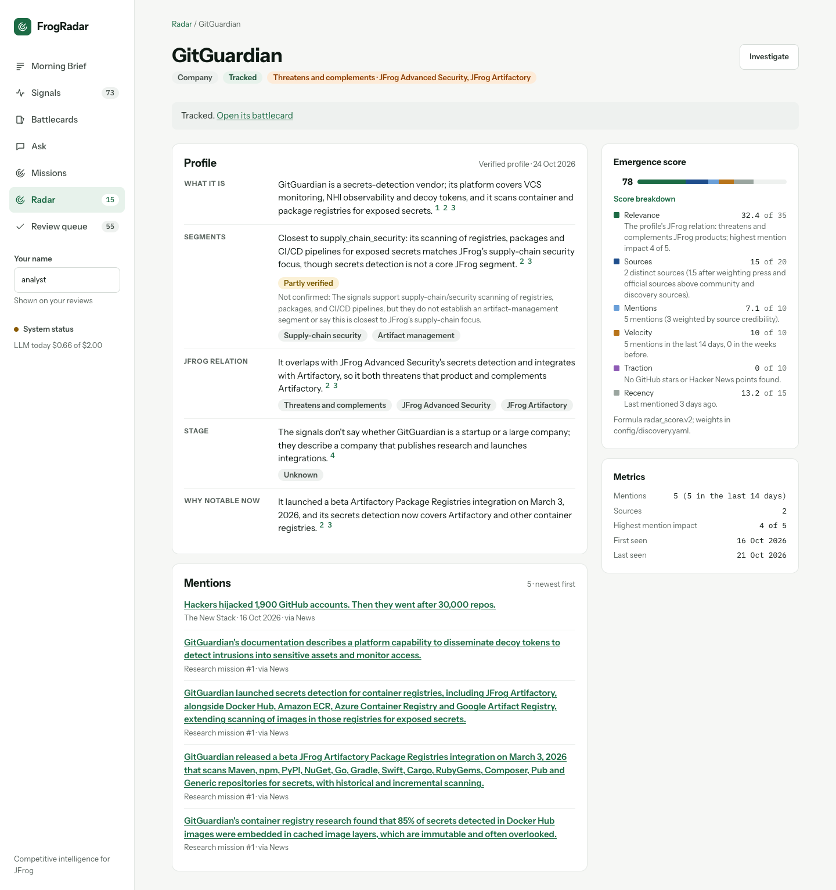

# The intelligence pipeline

<!-- Moved out of the README (S17). The README links here; keep both in sync. -->

Collection, page diffs, dedup, enrichment, verification, synthesis and the Competitor Radar.

## Collectors

Code: `backend/app/pipeline/collectors/`

`make collect` reads every active source and stores raw signals (no LLM calls):

- **RSS/Atom** (feedparser). Teaser items (< 500 chars) get the article fetched and the main text extracted
  (trafilatura); articles already stored are not fetched again.
- **GitHub releases** for the repos listed in `options.repos` (REST API; set `GITHUB_TOKEN` for 5000 instead of
  60 requests/hour). Drafts skipped, pre-releases flagged in `signals.meta`.
- **page_diff**: watched pages (pricing, features), see [Page diff watcher](#page-diff-watcher-and-wayback-baseline).
- **web**: stub (not planned yet).

Good citizenship: identifying User-Agent, robots.txt per host, ≥1s between requests to one host (Crawl-delay
honoured), conditional GET, timeouts. A failing source never stops the run; every run writes a `pipeline_runs`
row with per-source counts (new / updated / duplicate / failed / too old) and errors.

**History limits.** RSS feeds only list their most recent items (often 10–50), so a backfill can't reach further
back than the feed does; GitHub releases page back as far as `--since`. The collect/backfill report says per
source whether it covered the whole window or "only back to <date>". First 90-day backfill over the full catalog
(2026-10-20, before the source scope was narrowed):

| Coverage | Sources |
|---|---|
| Full 90 days | all 10 GitHub sources; Snyk, Chainguard, Cloudsmith, Hugging Face blogs; GitLab and Artifact Registry release notes |
| ~7 weeks | JFrog Blog (from 2 Sep), Azure DevOps Blog (from 11 Aug) |
| 2–4 weeks | Sonatype Blog, GitLab Blog, Endor Labs Blog, GitHub Blog, Socket Blog |
| Days | GitHub Changelog, The New Stack, InfoQ, BleepingComputer (high-volume feeds list only the latest items) |
| Not collected | Docker, OpenSSF and CNCF blogs block our HTTP client (403); we don't work around bot protection |

Feeds whose items are `#anchors` on one page (release notes) need `options.keep_fragment: true` so each entry
stays its own signal.

**Collected text is for analysis only.** `signals.raw_text` feeds enrichment, verification and search; it is never
shown in the UI or returned verbatim by the API/MCP. Users see a summary, a short evidence quote and a link to
the original.

## Page diff watcher and Wayback baseline

Pricing pages don't publish a feed, so FrogRadar keeps snapshots and reports what changed
(`backend/app/pipeline/page_diff.py`, `collectors/page_diff.py`, `wayback.py`).

- **Text:** the page's main content (trafilatura, or a CSS `options.selector`), normalized line by line: dates,
  "© 2026", "3 days ago", cookie and navigation lines removed; runs of very short lines joined (`$` `4`
  `per user/month` → `$ 4 per user/month`). Prices are never touched. Less than 500 characters left → the page
  probably needs JavaScript: the source fails, no snapshot.
- **Structure:** headings (h2–h4), tab panels (ARIA `aria-labelledby`) and parts named in `options.sections`
  (a CSS selector and a label, e.g. Sonatype's Cloud / Self-Hosted toggle) become path lines such as
  `# Nexus Repository > Cloud > Pro Edition`. Without them, Sonatype's two "Pro Edition" prices (Cloud $1,950,
  Self-Hosted $7,500) were indistinguishable. Each snapshot records its text format (`meta.normalizer`); snapshots
  of different formats are never compared, and `make wayback-backfill` re-fetches archived captures to upgrade them
  (`ONLY_AFTER=YYYY-MM-DD` limits which change signals it rewrites).
- **Snapshots:** stored only when the normalized text changed (`page_snapshots`, with `captured_at` = when the page
  looked like this and `meta.origin` live / wayback).
- **What counts as a change:** a line diff against the last snapshot that wasn't noise.
  - Lines that only moved are ignored, unless a feature moved from one plan's section to another's (a section is
    the lines under a price line).
  - Changes under 40 characters are noise, except that any change to a price line counts (`$4` → `$5`). Small
    edits add up, because the next diff is still taken against the last non-noise snapshot.
  - More than 50% of lines changed = a **redesign**: the snapshot is stored and marked `page_restructured`, and
    only the price lines of both versions are compared (`diff_mode: price_lines`), each prefixed with its section
    (`[Nexus Repository > Cloud > Pro Edition] Starting at $1,950 / year`). No price-line change → no signal. The
    stored evidence quote is the page text only; the section goes to `meta.quote_section`.
- **Signal:** title "Pricing page changed: <source>", dated to the later snapshot; its text is a readable diff of the
  changed sections only (`[before]`, `[after]`, `[context]` lines, a format note, and a list of features that moved
  between plans). It goes through triage → enrich → verify like any other signal, with its own prompt
  (`enrich_page_diff`: price, tier, limit or feature moved) and an evidence quote that must come from the
  `[after]` text, i.e. the current page. A change that only removed lines has no new text, so its quote comes
  from the removed `[before]` text (`meta.quote_side = "before"`, shown in the UI as "Removed: '…'").
- **Baseline:** `make wayback-backfill` takes the Wayback Machine capture closest to ~12, 6 and 3 months ago
  (within ±31 days; one CDX query, then the raw archived HTML via `id_` URLs, 5 s between requests). A capture whose
  text is under half of today's, or has no price lines while today's page has some, is reported as rendered
  differently and not stored, so no misleading diff is made across it. Missing captures are reported too.

**First baseline (2026-10-21):** 4 snapshots per page (2025-10-21, ~2026-04, ~2026-07, today), 6 change signals:

| Page | Change found |
|---|---|
| Sonatype, Oct → Apr | Nexus Repository editions renamed (Free → Community Edition, Premium → Nexus Repository + Repository Firewall) |
| Sonatype, Apr → Jul | Redesign (70% of lines): per-user monthly prices ($18.67, $57.50 per user/month) replaced by yearly ones ("Starting at $1,620 / year + consumption") |
| Sonatype, Jul → today | Redesign (71%): Nexus Repository split into Cloud and Self-Hosted; Cloud Pro Edition "$1,620 / year" → "$1,950 / year + consumption"; new Self-Hosted Pro Edition "$7,500 / year"; Lifecycle and SBOM Manager price cards removed |
| GitHub, Oct → Apr | "Team discussions" removed from the plan features |
| GitHub, Apr → Jul | Copilot add-on removed from the featured list; "GitHub sandbox (public preview)", usage-based, added |
| GitHub, Jul → today | Secret scanning split into "AI detection for alerts" / "for push protection" (usage-based); trial renamed |

## Dedup and entity linking

Code: `backend/app/pipeline/`

After collection, three steps run on in-scope signals (each `step(session, RunContext) -> counts`, one
`pipeline_runs` row per CLI run):

1. **Embed** (`embed.py`) – title + first 2,000 characters of the text, `text-embedding-3-small`, batched.
2. **Dedup** (`dedup.py`) – a signal joins a cluster only if it is similar enough to the cluster's *canonical*
   signal: ≥ 0.85 from another source, ≥ 0.97 from the same source (changelog entries share a template), within
   ±14 days. The canonical is the most trusted source, then the earliest. Duplicates are kept and point at it; the
   canonical lists its sources ("reported by 3 sources"). Re-running changes nothing.
3. **Link** (`link.py`) – names and aliases matched on word boundaries; ambiguous terms (Socket, Docker, GitHub)
   need a capital letter and the title or 3+ mentions; products win over their parent company. Primary = the
   source's own entity or named in the title; otherwise a mention. The LLM confirms/corrects links in enrichment.

First run on the active sources (56 signals, $0.00043 for embeddings): no cross-source duplicates – the closest
cross-source pair is 0.63, so the three sources don't report the same news yet; the most similar same-source
pair (two GitHub Copilot deprecation notices, 0.89) stays apart as intended. 43 entity links, at most 3 per
signal. `make dedup-report` shows the pairs and the similarity distribution for calibration.

## Daily pipeline: triage, enrichment, verification, confidence

`make pipeline` runs one LangGraph graph (`backend/app/pipeline/graph.py`):

```
collect → embed → dedup → link → triage → enrich → verify → score
```

One `pipeline_runs` row per run with counts per node. A failing node or signal is recorded and the run goes
on (status `partial`); running out of LLM budget skips the remaining LLM stages.

- **Triage** (`triage.v1`, cheap model): is this about JFrog's market (artifact management, supply-chain
  security, MLOps, CI/CD, distribution)? When unsure the answer is yes, because a missed signal costs more than
  an extra enrichment. Irrelevant signals are kept but hidden (`signals.relevant = false`), each with a reason.
- **Enrich** (`enrich_signal.v2`, cheap model): category (each with a one-line definition), 2–3 sentence summary, *why JFrog cares* (naming
  JFrog products; when the news is JFrog's own, framed as positioning against competitors), impact 1–5 against a
  written rubric, an evidence quote, vendor-claim flag, entities, new companies for the Competitor Radar, and
  capabilities. The evidence quote must appear verbatim in the article; this is checked in code. A near miss
  (a typo, a dropped word) is replaced by the real sentence it came from, but only for one sentence or two adjacent
  ones, at ≥ 90% similarity and ≥ 90% coverage, with the same numbers (`meta.quote_repaired`). Anything else is
  retried once, then flagged.
- **Verify** (`verify_signal.v2`, a model from a *different provider*, thinking off – see
  [Evaluation](EVALUATION.md)): are the summary and the facts behind *why JFrog cares* supported by the source?
  The JFrog-side analysis itself is not judged. Verdict: `supported` / `partial` / `unsupported`,
  with notes.
- **Score**: confidence is computed in code, never by a model.

**What confidence means:** how faithfully the signal reflects what its source says. It is *not* a judgement of
whether the source's claim is true. Vendor marketing claims carry a separate "vendor claim" label and don't
change confidence.

```
confidence = 0.45·verification + 0.25·source trust + 0.15·corroboration + 0.15·evidence quote
verification: supported 1 · partial 0.5 · unsupported 0      corroboration: 1 source 0 · 2 sources 0.5 · 3+ 1
caps: unsupported ≤ 0.30 · quote not verbatim ≤ 0.60          bands: high ≥ 0.75 · medium ≥ 0.50 · low
```

Weights, caps and bands are in `config/pipeline.yaml`; each signal stores its breakdown in `meta.score`.

**Untrusted input:** article text is wrapped in a block tagged with the text's own hash, so the text can't close the
block. Every prompt says the block is data, not instructions. The pipeline's own checks (verbatim quote, known
entity and capability slugs only, a second model from another provider, confidence in code) hold even if a model
follows injected text, and a test proves it.

**First run** (56 in-scope signals, $0.13 total):
- 26 relevant, 30 irrelevant
- 24 enriched; 2 failed because output was cut off at the old 1,024-token limit
- verification: 23 supported, 1 partial
- confidence: 23 high, 1 medium
- 0 unverified quotes

## Synthesis: daily brief and battlecards

Code: `backend/app/pipeline/synthesis/`

Two pipeline nodes after `score`, on the synthesis model. The pattern: **the LLM proposes, code verifies**.

- **Daily brief** (once per UTC day): the top 12 signals of the last 7 days → one top story: a plain title
  (≤ 90 chars, no claims about intent), what happened, why it matters for JFrog and a suggested move
  (`daily_brief.v3`). Title, what happened and why are required; a suggested move that fails a check is left out. Stored as a `reports` row (`daily_brief`).
- **Battlecards** (per competitor with at least 5 usable signals *about* it in the last 180 days, D86; weekly, or
  when a new impact ≥ 4 signal arrives; the API, Ask and MCP withhold a card below the threshold, also an older one):
  positioning, strengths, weaknesses, opportunities and blind spots for JFrog, plus capability levels. Stored as a
  `reports` row (`battlecard`); accepted levels go to `capability_matrix` with their evidence signal.
- **Checks, in order:** (1) every sentence / item cites signal ids; one id that is unknown, not usable, outside the
  input or about another company drops the whole item; (2) a capability level needs an evidence signal on which the
  competitor is primary; (3) one call to the verify model (another family) judges every remaining item against the
  summaries of the signals it cites, and statements about JFrog's own levels against `jfrog_capabilities.yaml`
  (trusted context, `verify_synthesis.v3`) – only `supported` is kept. Dropped items stay in the report with the reason
  and the verifier's note; they are never shown. The API re-checks at read time: an item is hidden once a cited
  signal stops being usable.
- **Page diffs** also get a `display_title` and proposed `price_changes`; a change is shown only if the old price
  is in a `[before]` line and the new one in an `[after]` line of the same change, with the same billing unit;
  the label comes from the page's section path.

Run 33 (S10): 80 calls, $0.216 – re-enrichment and re-verification of 32 signals, one brief, two battlecards.

## Competitor Radar: players nobody configured

Code: `backend/app/pipeline/radar/`

New tools and companies appear overnight; tracking the configured competitors can't surface them. The radar
finds candidates, ranks them with a transparent score, writes a short checked profile, and leaves the decision to
the analyst. **Nothing becomes a tracked entity unless an analyst approves it.**

**Discovery sources** (queries in `config/discovery.yaml`, one line each):
- **Hacker News** (Algolia HN Search API): stories whose *title* matches a keyword (≥ 15 points) and Show HN posts
  matching it in title or text (≥ 10 points), last 90 days. Typo tolerance is off: with it on, "SBOM" matched 286
  unrelated stories. The linked page's text (robots.txt respected) or the GitHub README is added.
- **GitHub search**: repositories created in the last 90 days by topic / description (≥ 30 stars). A code filter
  drops forks, archived repos, lists, tutorials, demos, courses, CTFs and homework before anything is stored.
  Stars go to `repo_star_snapshots` on every run (never into the text), so star velocity works across runs.
- **CNCF landscape**: a flattened copy of the watched categories is stored and diffed. Newly added names are
  candidates; a project that only moved category is not. The backfill uses the copies at -90 / -60 / -30 days
  (commits API).

Discovery items are ordinary signals (`meta.kind = discovery`). A stricter triage (`triage_discovery.v1`: relevant
only if the item's own product operates in one of JFrog's segments, not if it merely mentions MCP, a registry or
security) filters them, and `enrich_discovery.v1`
enriches them, naming the item's own subject as a new entity, with a URL only if it appears in the text. They are
not verified one by one, never join news dedup clusters and never appear in the Brief, feed or battlecards.

**Candidates**: from enrich's `new_entities` of *any* relevant signal (news included), plus relevant GitHub
repos and CNCF additions. Names are normalized ("Endor Labs" → `endor`, "socket.dev" → `socket`). A candidate is
skipped if it matches a tracked entity's name or alias, its website host, a GitHub org we already collect, or the
ignore list. Mentions attach by exact key, then repo URL, then homepage host (shared hosts like github.com never
count), then fuzzy (name ratio ≥ 0.92 **and** name-embedding cosine ≥ 0.90). A merge pass joins candidates that
turn out to be the same player, and every merge is logged on both rows.

**Emergence score** (0–100, `radar_score.v2`: relevance to JFrog first, popularity second; weights in
`discovery.yaml`, breakdown stored and returned by the API):

```
score = 100 × Σ weight × factor          (every factor in [0, 1])
relevance         0.35  no profile yet: (max enrich impact of the relevant mentions - 1) / 4
                        with a profile:  0.7 × relation weight + 0.3 × impact factor
                        (threatens 1.0 · both 1.0 · complements 0.6 · none 0.05)
mentions          0.10  ln(1 + weighted mentions) / ln(1 + 6)
source_diversity  0.20  weighted distinct sources / 2
mention_velocity  0.10  recent / (recent + prior × 14/76) × min(1, recent / 3)   recent = last 14 days of 90
traction          0.10  max(ln(1 + stars/day) / ln(1 + 50),  min(0.5, ln(1 + HN points) / ln(1 + 500)))
recency           0.15  0.5 ^ (days since last mention / 14)
```
"Weighted" means each mention or source counts by credibility: press and official 1.0, community and GitHub 0.5,
discovery sources (HN, GitHub search, CNCF) 0.35. One viral HN post adds at most 5 points. The profile's JFrog
relation counts if the statement was kept (supported or partly verified). A candidate whose
relation is "none" never appears in the Brief teaser. Star velocity is the difference between snapshots; on the
first sighting it is stars ÷ repo age (the breakdown says which).

**Profile** (top 10 candidates ≥ 35 points per run, regenerated when the mentions or the prompt change):
`radar_profile.v2` (bulk model) writes what it is, segments, JFrog relation (threatens / complements / both /
none + JFrog products), stage and why it is notable now. Each statement cites signal ids. Code drops any
statement citing an id it wasn't given. `verify_profile.v2` (verify model, other family) judges each statement
against the cited signals' text, the same excerpt the writer saw, with JFrog's product list as trusted context.
Same rule as research missions (check rule 2, S15): `supported` statements are shown as Verified; `partial` ones
(core right, a detail missing or overstated) are kept and shown as **Partly verified** with the verifier's note,
medium confidence at most; only `unsupported` statements (and invalid citations) are dropped. A profile is
rejected only if "what it is" is dropped. `make radar-recheck` moved the 11 stored profiles to this rule without
an LLM call (the verdicts and notes were stored): GitGuardian, Code Genome Project and StepSecurity went from
rejected to shown; VoidZero and abundant.ai stay rejected ("what it is" unsupported). Scores didn't change: the
ranking already counted partial relations.



GitGuardian ([390 px](screenshots/radar-gitguardian-390.png)): what it is, segments, JFrog relation
(complements JFrog Advanced Security, Artifactory, Xray) and stage are Partly verified, each with what wasn't
confirmed (e.g. "developer workstations or CI/CD pipelines" aren't in the cited sources); why notable now is
Verified. Mentions from research missions show "Research mission #N" as their source.

**Analyst actions** (`/api/radar`): list by score (filters `status`, `relation`, `kind`), detail (cited statements, mentions, merges), `watch`,
`approve` (creates an entity `discovered_by radar`, relationship competitor by default, aliases from merged names,
and optionally a *disabled* GitHub releases source) and `dismiss` (reason code). Each action writes a `feedback`
row. The Brief's right rail shows "New on the radar" (top 3, watching badge, score, sources); the Radar page is
described under "Signals, Battlecard and Radar pages".

**First run (S11, 2026-10-21)**: HN 301 stories (144 relevant), GitHub 96 repos (78 relevant, 12 dropped by the
noise filter), CNCF 7 additions (1 relevant) → 249 observations → 159 candidates (153 via discovery sources, 5
via news `new_entities`). Cost $0.53: triage $0.12, enrich $0.32, profiles + checks $0.09.

**Tuning round (radar_score.v2 + triage_discovery.v1)**: the first ranking put an email app, a Redis clone and a
WhatsApp MCP server in the top 10. The reason: segment overlap gave 149 of 159 candidates full points, HN points
decided the rest, and players found in news had no traction. Re-triage kept 103 of 404 discovery items (223
before). 71 candidates remain; all three false positives are gone. The new top 3 are PatchWave (Dependabot PR
review), Primod (Kubernetes runtime security, new in the CNCF landscape) and Code Genome Project (OpenRewrite's
new Maven repository). GitGuardian and StepSecurity rose from #66–67 to #5–6: their only evidence is one article
citing their analysis of an attack, so their profiles say "relation: none". Cost $0.150 (re-triage $0.124).

Still open: the verifier marks many segment / stage statements partial; players with a single press mention stay
mid-table until more evidence arrives.

### Known limitations
- No authentication: the radar's write endpoints are open and record the analyst as "anonymous" (signal reviews
  use the name typed in the sidebar).
- GitHub without `GITHUB_TOKEN`: 10 searches/minute (requests are spaced 6.5 s); the CNCF history uses 3 core-API
  calls (60/hour unauthenticated).
- Star velocity is an average over the repo's age until a second daily snapshot exists.
- Discovery signals are not verified one by one; only the profile statements are.
- Research missions' SSRF guard resolves a host's DNS in the check and the HTTP client resolves it again when it
  connects (lookup separate from connect). A host that answers with a public address first and a private one
  second (DNS rebinding) could get through. Closing it means connecting to the checked IP (pinning).
